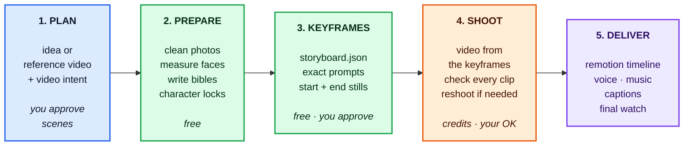

# 🎬 Flow Film Director

> **The AI Film Crew for Google Flow & Programmatic Video Engineering**
> Direct Google Flow (Veo / Omni video, Nano Banana stills) with persistent character identity, authentic cloned voices across languages, and programmatic timeline editing in Remotion.

[](https://deepmind.google/technologies/gemini/)
[](https://claude.ai)
[](https://labs.google/flow)
[](https://github.com/jamiepine/voicebox)
[](https://www.remotion.dev)
[-6366F1?logo=sparkles&logoColor=white)](https://www.agensi.io/skills/flow-film-director)
[](LICENSE)

Flow Film Director transforms generative AI video from single disconnected clips into **repeatable, studio-grade films**. It operates like an autonomous film crew: enforcing face likeness across every scene, matching reference choreography shot for shot, cloning authentic character voices, and rendering programmatic timelines in React via Remotion.

> 💡 **Community vs. Pro Edition:** You are viewing the **Free Community Edition**. Stop burning through expensive Google Flow credits on warped faces and rubber limbs! Unlock automated numerical likeness scoring, MediaPipe stunt matching, and Voicebox voice cloning with the [**Flow Film Director Pro Studio on Agensi ($4.99)**](https://www.agensi.io/skills/flow-film-director).

---

## 💎 Free Community Edition vs. Pro Studio Edition ($4.99)

Flow Film Director is distributed under an **Open Core** model:
- **Free Community Edition (GitHub):** Designed for indie developers exploring Google Flow. Includes basic Flow MCP orchestration, standard prompt recipes, and manual visual checklists.
- **🚀 Pro Studio Edition (Agensi - $4.99):** The full, automated production suite that saves creators hundreds of wasted Google Flow credits. Unlocks automated mathematical face scoring, stunt motion matching, Voicebox voice cloning, and Remotion React timeline assembly.

| Capability | Free Community (GitHub) | 🚀 Pro Studio Edition (Agensi) |
|---|:---:|:---:|
| **Google Flow MCP Orchestrator** | ✅ Included | ✅ Included |
| **Fast Mode Storyboard Compiler** | ✅ Included | ✅ Advanced Parallel Pipeline |
| **Character Bible Prompt Templates** | ✅ Manual | ✅ Automated Forensic Photo Cleaner (`prep_refs.py`) |
| **SFace Forensic Likeness Verification** | ❌ Manual Visual Check | 🔒 **Automated OpenCV YuNet + SFace ($\ge 0.50$ Score)** |
| **Shot-by-Shot Stunt / Motion Remake** | ❌ Not Included | 🔒 **MediaPipe Pose Tracking & Motion Matcher** |
| **Product & Brand Invariant Locking** | ❌ Text Description Only | 🔒 **SIFT Geometric Keypoint Verification (`object_check.py`)** |
| **Biometric Voice Cloning & Speech Ducking** | ❌ Generic Flow Voice | 🔒 **Voicebox Multilingual Studio (-14 LUFS Mix)** |
| **Remotion Programmatic Video Timeline** | ❌ Not Included | 🔒 **React Timeline Editor & Kinetic Subtitles** |
| **Automated Defect Remediation Loops** | ❌ Not Included | 🔒 **Fast Review Auto-Retake Engine (`fast_review.py`)** |
| **Commercial Studio License & Showcase Presets**| ❌ Community Only | 🔒 **Full Commercial License + Production Presets** |

<p align="center">
  <a href="https://www.agensi.io/skills/flow-film-director">
    
  </a>
</p>

---

## 📑 Table of Contents

- [💡 Overview & Core Value](#overview-core-value)
- [🚀 Key Features at a Glance](#key-features-at-a-glance)
- [⚡ Quick Start (< 5 Minutes)](#quick-start-5-minutes)
- [📦 Installation & Setup](#installation-setup)
  - [0. Prerequisites](#0-prerequisites)
  - [1. ⚡ Master One-Click All-in-One Installer](#1-master-one-click-all-in-one-installer-recommended)
  - [2. Optional Companions](#optional-companions)
- [🎯 How to Use & Workflows](#how-to-use-workflows)
  - [1. The Autonomous video-creator Agent](#1-the-autonomous-video-creator-agent)
  - [2. Slash Command & Interactive Interview](#2-slash-command-interactive-interview)
  - [3. Supported Video Intents](#3-supported-video-intents)
- [🎬 Production Showcase Examples](#production-showcase-examples)
  - [Example 1: Hassen's Story (Docu-Narrative with Arabic Voiceover)](#example-1-hassens-story-docu-narrative)
  - [Example 2: Marwen & Hassen (Multi-Character Superhero Remake)](#example-2-marwen-hassen-action-superhero-remake)
- [📘 Creator Production Playbook & Prompt Recipes](#creator-production-playbook-prompt-recipes)
  - [The 4 Golden Production Rules](#the-4-golden-production-rules)
  - [Production Prompt Recipes (Keyframes, Video Motion)](#production-prompt-recipes)
  - [Actions That Break vs. Production Fixes](#actions-that-break-vs-what-to-do-instead)
- [🎙️ Quad-Engine Voice Suite & Voicebox Integration](#quad-engine-voice-suite-voicebox-integration)
  - [The 4 Voice Engines (Voicebox, ElevenLabs, RVC, Local)](#the-4-voice-engines)
  - [How to Use Voicebox with Flow Film Director](#how-to-use-voicebox)
  - [Audio Modes & Sidechain Ducking](#audio-modes)
  - [Interactive Diagnostics & Commands](#interactive-diagnostics-commands)
- [✂️ Programmatic Video Editing (Remotion)](#programmatic-video-editing-timeline-automation-remotion)
  - [Remotion Agent Skills Pack](#remotion-agent-skills-pack)
  - [Step-by-Step Environment Setup](#step-by-step-environment-setup-verification)
  - [Declarative React Timeline Example](#declarative-react-timeline-architecture)
  - [Headless CLI Rendering & Parameter Passing](#headless-cli-rendering-parameter-passing)
  - [AI Video Engineering Prompt Guide](#ai-video-engineering-prompt-guide)
  - [Pinpoint Timeline Frame Editing (edit_video.py)](#pinpoint-timeline-frame-editing-edit_videopy)
- [🏗️ Pipeline Architecture & Verification Gates](#pipeline-architecture-verification-gates)
  - [The 5-Step Production Lifecycle](#the-5-steps)
  - [Measured Gates & Calibrated Thresholds](#measured-gates-calibrated)
  - [Directory Layout](#what-is-inside)
  - [Flow Credit Costs](#costs-flow-credits-from-flow-mcp-measurements)
- [🧪 Tests & Verification](#tests)
- [⚠️ Known Limits & Troubleshooting](#known-limits)
- [🛡️ Responsible AI Use](#responsible-use)
- [📜 Credits & License](#credits-license)

---

<a id="overview"></a><a id="overview-core-value"></a><a id="overview--core-value"></a>
## 💡 Overview & Core Value

Text-to-video models are great at generating one beautiful clip, but they break down when making a **coherent film**:
- Faces drift into "distant cousins" between cuts.
- Clothes, accessories, and rooms randomly change style and color.
- Physical motions glitch: rubber limbs, mutant fingers, objects popping into existence.
- Dialogue voices sound like generic stock robotic TTS with zero emotion.

**Flow Film Director fixes this by enforcing real film production discipline:**

```
┌────────────────────────────────────────────────────────────────────────┐
│                      DETERMINISTIC FILM LIFECYCLE                      │
├────────────────────────────────────────────────────────────────────────┤
│ 1. Cast & Lock     │ Forensic photo cleaning, SFace embedding audit    │
│ 2. 0-Credit Board  │ Free Nano Banana start/end stills (0 credits)     │
│ 3. Pixel Animation │ Video is animated FROM locked keyframe pixels     │
│ 4. Measured Gates  │ OpenCV & MediaPipe audit identity & pose motion   │
│ 5. Real Voices     │ Quad-engine voice cloning with sidechain ducking  │
│ 6. React Timeline  │ Programmatic editing, kinetic captions in Remotion│
└────────────────────────────────────────────────────────────────────────┘
```

---

<a id="features"></a><a id="key-features-at-a-glance"></a>
## 🚀 Key Features at a Glance

| Capability | How It Works | Benefit |
|---|---|---|
| **Autonomous `video-creator` Agent** | Pre-configured agent persona in Antigravity & Claude Code | Manages casting, generation, audio, and post-production without prompt drift. |
| **Identity Lock (SFace & YuNet)** | Crops, cleans, and measures face embeddings across angles | Subject remains identical across every take ($\ge 0.50$ similarity). |
| **0-Credit Keyframe Gating** | Generates Nano Banana stills first before triggering paid video | Validates framing and identity for 0 credits before spending budget. |
| **Shot-by-Shot Remakes** | MediaPipe Pose extracts joint angles from reference videos | Matches camera framing, duration, and choreography beat for beat. |
| **Quad-Engine Voice Suite** | Voicebox (Local Open-Source), ElevenLabs, Local RVC, and Local Zero-Shot | Free local voice studio & cloud generation across 23+ languages with automatic ducking. |
| **Programmatic Video Editing** | Remotion React timeline & Chromium headless renderer | Replaces desktop editors; builds kinetic captions, lower-thirds, and transitions. |
| **Fast Mode (Default)** | Parallel batch generation with human-paced rate-limiting | 5-scene narrative film in ~5.8 minutes (35 Flow credits). |

---

<a id="quick-start"></a><a id="quick-start-5-minutes"></a><a id="quick-start--5-minutes"></a>
## ⚡ Quick Start (< 5 Minutes)

### 1. Launch the Agent in Google Antigravity
1. Open your project in **Google Antigravity**.
2. In the bottom bar, click the **Agents dropdown** (next to model selection) and select [**`video-creator`**](agents/video-creator.md).
3. Type:
   > *"Check my Flow session and make a 30s 9:16 docu-narrative film of me (photos in `C:\photos\me`)."*

### 2. Launch in Claude Code
```bash
claude
# Inside Claude Code:
/flow-film-director
```

### 3. Verify Local Services & Environment
```bash
# Check Flow session & Python environment
python skills/flow-film-director/scripts/setup_env.py

# Check Voice Engines readiness (Voicebox / ElevenLabs / RVC / Local)
python skills/flow-film-director/scripts/setup_voice_engine.py --audit

# Start Remotion Studio Web Preview
cd remotion_studio && npx remotion studio --no-open
```
> **Tip**: Voicebox is the default, 100% free voice studio running locally at `http://127.0.0.1:17493` — no API keys required!

---

<a id="installation"></a><a id="installation-setup"></a><a id="installation--setup"></a>
## 📦 Installation & Setup

### 0. Prerequisites

| Requirement | Supported Version | Check Command | Installation |
|---|---|---|---|
| **OS** | Windows 10/11 or macOS (Linux: untested) | - | - |
| **Node.js** | **v22+** (required for flow-mcp & Remotion) | `node -v` | [nodejs.org](https://nodejs.org/) |
| **Python** | **3.10+** | `python --version` | [python.org](https://www.python.org/) |
| **Google Chrome** | Latest stable | - | Required for Google Flow automation |
| **Google Flow Account** | Active project at [labs.google/flow](https://labs.google/flow) | - | Free tier: 50 credits/day |
| **FFmpeg** | Latest | `ffmpeg -version` | Windows: `winget install Gyan.FFmpeg`<br/>macOS: `brew install ffmpeg` |

> [!IMPORTANT]
> Keep your computer and display awake while Flow is generating: `flow-mcp` automates a live Chrome browser session.

---

<a id="master-installer"></a><a id="1-master-one-click-all-in-one-installer-recommended"></a>
### 1. ⚡ Master One-Click All-in-One Installer (Recommended)

Rather than running dozens of individual commands, the master installer automatically asks you what assistant you want (**Google Antigravity**, **Claude Code**, or **Both**) and configures everything in one step:

```
┌────────────────────────────────────────────────────────────────────────┐
│                   FLOW FILM DIRECTOR ALL-IN-ONE SETUP                  │
├────────────────────────────────────────────────────────────────────────┤
│ 1. Assistant Detection │ Asks whether to install in Antigravity/Claude │
│ 2. Agent & Skills Pack │ Deploys 'video-creator' agent & all 10 skills │
│ 3. flow-mcp Bridge     │ Clones, builds, patches, & registers MCP      │
│ 4. Remotion Skills     │ Installs official Remotion video editing suite│
│ 5. Isolated Python Env │ Prepares ~/.flow-film/venv with SFace/YuNet   │
└────────────────────────────────────────────────────────────────────────┘
```

#### Run the Interactive Installer:
```bash
# Cross-Platform (Windows, macOS, Linux)
git clone https://github.com/HassenChaaben/flow-film-director.git
cd flow-film-director
python install.py
```

*Or via platform-native scripts:*
```powershell
# Windows PowerShell
powershell -ExecutionPolicy Bypass -File install.ps1
```
```bash
# macOS / Linux
./install.sh
```

#### Non-Interactive One-Liners (Instant Setup):
```bash
# Install to both Antigravity & Claude Code with all defaults
python install.py --yes --target both

# Install to Google Antigravity only
python install.py --yes --target antigravity

# Install to Claude Code only
python install.py --yes --target claude

# Include local PyTorch CUDA voice cloning environment (~3-4 GB)
python install.py --yes --target both --with-voices
```

---

<details>
<summary><b>🔧 Advanced: Manual Step-by-Step Installation</b></summary>
<br/>

If you prefer configuring each component by hand:

#### Step A: Install flow-mcp (Google Flow Bridge)
```bash
git clone https://github.com/GTAI-1/flow-mcp.git
cd flow-mcp
npm install
npm run build
npm run login
```

#### Step B: Register flow-mcp in Google Antigravity
Add the server to `%USERPROFILE%\.gemini\config\mcp_config.json`:
```json
{
  "mcpServers": {
    "flow": {
      "command": "node",
      "args": ["C:\\absolute\\path\\to\\flow-mcp\\dist\\index.js"],
      "disabled": false,
      "timeoutSeconds": 600
    }
  }
}
```

#### Step C: Register flow-mcp in Claude Code
```bash
claude mcp add --scope user flow -- node /absolute/path/to/flow-mcp/dist/index.js
```

#### Step D: Copy Skills & Agent Manually
- Copy `skills/*` into `~/.gemini/config/skills/` (Antigravity) and/or `~/.claude/skills/` (Claude Code).
- Copy `agents/video-creator.md` into `~/.gemini/config/agents/` and/or `~/.claude/agents/`.
- Run `python skills/flow-film-director/scripts/setup_env.py`.

</details>

---

<a id="optional-companions"></a><a id="2-optional-companions"></a><a id="4-optional-companions"></a>
### 2. Optional Companions

- **[watch-video](https://github.com/MarcinSufa/claude-watch-video)** (Visual Quality Review):
  ```bash
  /plugin install watch-video@claude-watch-video
  ```
  Allows the agent to watch rendered takes frame by frame to inspect motion and facial realism.
- **[VideoDB](https://github.com/video-db/skills)** (Semantic Cloud Search & Automatic Dubbing):
  ```bash
  /plugin install videodb@videodb-skills
  /videodb:setup
  ```

---

<a id="how-to-use"></a><a id="how-to-use-workflows"></a><a id="how-to-use--workflows"></a>
## 🎯 How to Use & Workflows

### 1. The Autonomous `video-creator` Agent

Switch your agent role to **`video-creator`** in Antigravity (bottom bar dropdown) or invoke it in Claude Code:

<p align="center">
  <br/>
  <i>In Google Antigravity: Click the Agent selector in the bottom bar next to the model picker and select <b>video-creator</b></i>
</p>

The agent autonomously handles:
1. **Intake & Interview**: Asks for your video intent, target duration, aspect ratio (16:9 or 9:16), and reference files.
2. **Subject Profiling**: Cleans your photos using `prep_refs.py`, measures face geometry with `ref_audit.py`, and writes a locked character bible.
3. **0-Credit Storyboarding**: Creates start and end keyframes in Google Flow via Nano Banana stills (0 credits).
4. **Interactive Approval**: Pauses to show you the keyframe contact sheet before spending a single credit.
5. **Generative Shooting**: Submits Veo/Omni requests with rate-limiting, measures each take against identity and pose gates, and fixes issues.
6. **Voice & Master Audio**: Clones character voices from voice notes, ducks the soundtrack, and masters to -14 LUFS.
7. **Timeline Delivery**: Generates a reproducible Remotion project and final MP4 master.

---

### 2. Slash Command & Interactive Interview

You can start the workflow in any conversational session with:
```text
/flow-film-director
```

**Common Natural Prompts:**
- **Personalized Story**: *"Make a 45-second docu-narrative film about my journey from student to AI engineer. Photos in `C:\photos\me`, voice note in `C:\audio\voice.ogg`."*
- **Action Remake**: *"Remake `C:\clips\fight_scene.mp4` from 0:10 to 0:35 with me and my friend as superheroes in tactical armor."*
- **E-Commerce / UGC Ad**: *"Make a 15-second 9:16 product video for this perfume bottle (`C:\product\`), modern studio lighting, elegant camera rotation."*
- **Old Photo Animation**: *"Animate this historic portrait of my grandfather (`C:\photos\grandpa.jpg`), subtle breathing, gentle smile, physically realistic."*

---

### 3. Supported Video Intents

| Intent | Primary Metric / Check | Best Generation Strategy |
|---|---|---|
| **Remake Reference Video** | Pose joint similarity ($\ge 0.70$) & framing match | Veo 3.1 Fast with motion match scoring |
| **Story / Short Film** | Face identity ($\ge 0.50$ SFace), scene continuity | Omni 1.1 Flash from approved keyframes |
| **Talking Head / UGC** | Lip-sync, facial realism, audio clarity | Veo 3.1 with real cloned voiceover |
| **Product Ad / E-Commerce** | SIFT feature inliers ($\ge 40$), label fidelity | Keyframe lock on product geometry |
| **Social Reel (9:16)** | Visual hook in $\le 2$s, kinetic subtitle sync | Remotion timeline with animated captions |
| **Music / Lyric Video** | Beat alignment ($\le 12$ ms), tempo-synced cuts | Audiokit beat tracking with auto-cuts |
| **Animated / Stylized** | Texture consistency, style palette | Nano Banana style-transfer stills |

---

<a id="showcase"></a><a id="production-showcase-examples"></a>
## 🎬 Production Showcase Examples

Real-world production films directed autonomously with Flow Film Director via `flow-mcp`. Full engineering details in [**`examples/showcase/METHODOLOGY.md`**](examples/showcase/METHODOLOGY.md).

---

<a id="example-1"></a><a id="example-1-hassens-story-docu-narrative"></a><a id="example-1-hassens-story--docu-narrative"></a>
### Example 1: Hassen's Story — Docu-Narrative

<table>
  <thead>
    <tr>
      <th width="35%" align="center">Before (Reference Portrait)</th>
      <th width="65%" align="center">After (Directed Film)</th>
    </tr>
  </thead>
  <tbody>
    <tr>
      <td align="center" valign="middle">
        
      </td>
      <td align="center" valign="middle">
        <a href="examples/showcase/example1_hassen_story/hassen_story.mp4" title="Click to watch full 54.5s film with sound">
          
        </a>
        <br/>
        <sub><a href="examples/showcase/example1_hassen_story/hassen_story.mp4">▶ <b>Watch Full Film with Arabic Voiceover (54.5s MP4)</b></a></sub>
      </td>
    </tr>
  </tbody>
</table>

<p align="center">
  <sub><b>Result:</b> 54.5s Cinematic Docu-Narrative across 8 scenes with authentic Tunisian Arabic voiceover and ducked soundtrack. Face similarity: <b>0.60–0.69</b>.</sub>
</p>

<details>
<summary><b>🎬 View 8-Scene Sequence Breakdown</b></summary>
<br/>

1. **Scene 1 (Tunisia Roots)**: Sunlit study desk with engineering books and laptop.
2. **Scene 2 (Departure)**: Airport terminal overlooking runway with travel bag.
3. **Scene 3 (UNIVPM Study)**: Historic Italian university stone cloister library.
4. **Scene 4 (Academic Pride)**: Campus cloister walkway, confident smile.
5. **Scene 5 (Robotics Lab)**: Entering the state-of-the-art mechatronics laboratory.
6. **Scene 6 (AI Engineering)**: Dual-monitor workstation reviewing PyTorch deep learning curves.
7. **Scene 7 (Coastal Reflection)**: Adriatic coastal terrace in Ancona at golden hour.
8. **Scene 8 (Closing Inspiration)**: Studio close-up delivering direct motivational message.

</details>

---

<a id="example-2"></a><a id="example-2-marwen-hassen-action-superhero-remake"></a><a id="example-2-marwen--hassen--action--superhero-remake"></a>
### Example 2: Marwen & Hassen — Action / Superhero Remake

<table>
  <thead>
    <tr>
      <th width="35%" align="center">Before (Reference Photos)</th>
      <th width="65%" align="center">After (Directed Action Remake)</th>
    </tr>
  </thead>
  <tbody>
    <tr>
      <td align="center" valign="middle">
        
        &nbsp;
        
      </td>
      <td align="center" valign="middle">
        <a href="examples/showcase/example2_marwen_hassen_action/marwen_hassen_action.mp4" title="Click to watch full 51.5s action film">
          
        </a>
        <br/>
        <sub><a href="examples/showcase/example2_marwen_hassen_action/marwen_hassen_action.mp4">▶ <b>Watch Full Action Film with Cinematic Score (51.5s MP4)</b></a></sub>
      </td>
    </tr>
  </tbody>
</table>

<p align="center">
  <sub><b>Result:</b> 51.5s Two-Person Choreographed Stunt Sequence. Zero face morphing, tactical armor preserved, timed katana strikes.</sub>
</p>

---

<a id="playbook"></a><a id="creator-production-playbook-prompt-recipes"></a><a id="creator-production-playbook--prompt-recipes"></a>
## 📘 Creator Production Playbook & Prompt Recipes

### The 4 Golden Production Rules

1. **Rule 1: Lock Identity in Pixels, Never Trust Text Alone**  
   Never rely solely on prompting *"a man with glasses"*. Generate a verified 0-credit Nano Banana still first, confirm likeness ($\ge 0.55$), and pass that exact image as the starting frame for video animation.
2. **Rule 2: Restrict One Take to One Grounded Action**  
   Video diffusion fails on compound instructions (*"he runs, jumps, opens a door, and drinks coffee"*). Break actions into single physical beats: *"he reaches out and picks up the mug"*.
3. **Rule 3: Give Hands a Physical Anchor**  
   Free-floating hands trigger mutant finger hallucinations. Always specify an object anchor: *"left hand resting flat on desk, right hand holding ceramic coffee mug"*.
4. **Rule 4: Keep Framing at Medium / Medium-Close**  
   In wide shots, faces shrink to $<40$ pixels, causing glasses and eyes to blur into goggles. Keep key character moments at **Medium Close-Up (MCU)** or **Medium Shot (MS)**.

---

### Production Prompt Recipes

#### 1. 0-Credit Verification Still (Phase 3)
```text
Photorealistic cinematic portrait of [CHARACTER NAME], eye-level angle, 85mm prime cinema lens. [CHARACTER NAME] is seated in a modern robotics laboratory, body angled 30 degrees toward camera-right, warm confident smile. Both hands rest naturally on the clean wooden desk. In the background, soft out-of-focus robotic arms and warm amber ambient light.
[PASTE CHARACTER LOCK TEXT FROM BIBLE].
Photorealistic, authentic skin pores and micro-textures, natural studio lighting, no extra people, no artifacts, cinematic 8k color grade.
```

#### 2. Video Animation & Camera Motion (Phase 5)
```text
The shot begins exactly on the provided first frame. [CHARACTER NAME] slowly turns their head 20 degrees toward camera-front, maintaining a confident, focused expression. Camera executes a very slow, smooth push-in (dolly forward 10 cm). Real-time natural human speed, realistic eye micro-saccades and natural blinking, facial structure remains 100% identical to the keyframe for the entire shot.
Quiet laboratory ambience, subtle background hum.
[PASTE SHORT CHARACTER LOCK, 30 words].
Photorealistic, physically plausible human weight, no rubber limbs, no face morphing.
```

---

### Actions That Break vs. What to Do Instead

| Broken Action | Why It Breaks in AI | Production Solution |
|---|---|---|
| **90° Side Profile Walking** | Face is only 25px wide; glasses distort. | Shoot at **3/4 view (30°–45° toward camera)** where face is $>100$px. |
| **Full Sprinting / Running** | Diffusion cannot resolve ground-foot collision. | Show the subject **starting or stopping**, or frame as **waist-up medium**. |
| **"He laughs hysterically"** | Model hallucinates gaping mouths, extra teeth. | Prompt: **"Gentle confident smile, eyes creasing warmly"**. |
| **Unanchored / Floating Hands** | Triggers 6-finger mutations. | Give hands a **physical anchor** (*"holding notebook"*, *"fingers on keyboard"*). |
| **Whip Pans & Fast Drone Spins** | Motion blur destroys facial recognition. | Use **slow cinematic push-ins, subtle lateral tracking, or locked tripod**. |

📖 **Full Creator Playbook**: Read the detailed choreography and multi-actor guide in [**`docs/PRODUCTION_GUIDE.md`**](docs/PRODUCTION_GUIDE.md).

---

<a id="voice"></a><a id="quad-engine-voice-suite"></a><a id="quad-engine-voice-suite-voicebox-integration"></a><a id="tri-engine-voice-architecture"></a><a id="voicebox"></a>
## 🎙️ Quad-Engine Voice Suite & Voicebox Integration

Flow Film Director features a comprehensive **Quad-Engine Voice Architecture**, integrating cloud studio generation, local AI voice applications, and offline neural conversion so characters speak with their authentic voices across any language or dialect:

> [!TIP]
> **Voicebox is the Default Voice Engine**  
> The autonomous `video-creator` agent and `voice_convert.py` default to **Jamie Pine's Voicebox** (`--engine voicebox` or Voicebox MCP) whenever voice cloning, dialogue generation, or narration is requested without explicitly specifying ElevenLabs. Voicebox is 100% free, runs locally on your PC (`http://127.0.0.1:17493`), and requires zero API keys or token costs.

<a id="the-4-voice-engines"></a><a id="the-3-voice-engines"></a>
### The 4 Voice Engines

| Engine | Best For | Technical Workflow | Requirements | Cost |
|---|---|---|---|---|
| **1. Voicebox Local Studio** (`--engine voicebox`) | **100% Free local AI voice studio & agent MCP** ([jamiepine/voicebox](https://github.com/jamiepine/voicebox)). Privacy-first, 8 local TTS engines (Kokoro, Qwen3-TTS, Chatterbox), Whisper dictation. | Runs desktop Voicebox app on `http://127.0.0.1:17493`. Clones voices from audio samples, exposes local REST API & native MCP server. | Voicebox Desktop App / Server | **100% Free & Open-Source** |
| **2. ElevenLabs Studio** (`--engine elevenlabs`) | **Broadcast-quality trilingual voiceover** (Tunisian Arabic, French, English). Natural human breathing, emotional cadence, dialectal idioms. | Uploads voice note (WhatsApp audio) to ElevenLabs Voice Lab, builds biometric clone, synthesizes via Multilingual v2. | `ELEVENLABS_API_KEY` | Free trial / Starter ($1 promo) |
| **3. Local RVC Transfer** (`--engine rvc`) | **100% Free natural human emotion.** Zero synthetic TTS artifacts. | You speak lines into your phone with natural acting; RVC converts vocal tract resonance to character timbre. | NVIDIA GPU / CPU Fallback | **100% Free** |
| **4. Local Zero-Shot** (`--engine local`) | **100% Free offline GPU TTS.** Runs completely on your PC without APIs or manual voice recording. | Synthesizes speech locally from written text using Chatterbox & PerthNet models in `~/.flow-film/voice-venv`. | NVIDIA GPU (CUDA) | **100% Free** |

---

<a id="voicebox-guide"></a><a id="how-to-use-voicebox"></a>
### 🎙️ How to Use Voicebox with Flow Film Director (Detailed Guide)

[**Voicebox**](https://github.com/jamiepine/voicebox) (by Jamie Pine) is the #1 trending open-source AI voice studio on GitHub (50K+ stars, 2.6M downloads). It is a **100% free, local-first alternative to ElevenLabs and WisprFlow** that runs entirely on your own machine with zero subscription fees and zero cloud data leaks.

```
┌────────────────────────────────────────────────────────────────────────┐
│                        VOICEBOX LOCAL STACK                            │
├─────────────────────┬──────────────────────────────────────────────────┤
│ 1. Engine Options   │ Kokoro 82M, Qwen3-TTS, Chatterbox, HumeAI TADA   │
│ 2. Voice Cloning    │ Zero-shot cloning from 3–5 seconds of audio      │
│ 3. Dictation / STT  │ Local Whisper turbo transcription                │
│ 4. Built-in MCP     │ Native agent interface at http://127.0.0.1:17493 │
└─────────────────────┴──────────────────────────────────────────────────┘
```

#### Step 1: Install & Launch the Voicebox Desktop App
1. Download the installer for Windows or macOS from [**github.com/jamiepine/voicebox**](https://github.com/jamiepine/voicebox).
2. Open Voicebox and keep it running in the background. The app automatically exposes:
   - **Local REST API**: `http://127.0.0.1:17493`
   - **Agent MCP Server**: `http://127.0.0.1:17493/mcp`

#### Step 2: Connect Voicebox to Your Agent (One-Click)
The master installer (`python install.py`) configures this automatically. If configuring manually:

- **Google Antigravity**: Add `voicebox` to `%USERPROFILE%\.gemini\config\mcp_config.json`:
  ```json
  {
    "mcpServers": {
      "voicebox": {
        "url": "http://127.0.0.1:17493/mcp",
        "transport": "http",
        "disabled": false
      }
    }
  }
  ```
- **Claude Code**:
  ```bash
  claude mcp add --scope user voicebox -- npx -y mcp-remote http://127.0.0.1:17493/mcp
  ```

#### Step 3: Run the Engine Diagnostic Audit
Verify that Flow Film Director detects your running Voicebox instance:
```bash
python skills/flow-film-director/scripts/setup_voice_engine.py --audit
```
*Expected Output:*
```text
[2] Voicebox Local Voice Studio (100% Free Open-Source & MCP)
  Status:         ONLINE (http://127.0.0.1:17493)
  Profiles:       1 voice profile(s) loaded
  MCP Server:     READY at http://127.0.0.1:17493/mcp
  Features:       Local zero-shot cloning, Kokoro & Qwen3-TTS, Whisper STT.
```

#### Step 4: Clone a Character Voice
You can create voice profiles in two ways:
- **Interactive UI**: Inside the Voicebox app, record 5–10 seconds of speech with your microphone or drop a voice memo.
- **Automated Agent Cloning**: Pass your character's WhatsApp voice note (`.ogg`, `.mp3`, `.wav`) to `voice_convert.py`. Flow Film Director will automatically convert the audio to 24 kHz WAV and register the profile in Voicebox on first generation.

#### Step 5: Synthesize Dialogue Lines via CLI
```bash
# Synthesize English narration using Voicebox's Kokoro engine
python skills/flow-film-director/scripts/voice_convert.py speak \
  --engine voicebox \
  --profile "film/my-film/voices/Marwen/profile.json" \
  --text "Welcome to the robotics lab, let's build something great." \
  --out "vo/line-01.wav"
```

#### Step 6: Collaborate with the `video-creator` Agent
When interacting with the autonomous agent in Antigravity or Claude Code, prompt naturally:
- *"Voice scene 2 using Voicebox with my cloned voice profile."*
- *"Generate dialogue for all character lines using Voicebox and apply sidechain ducking to the soundtrack."*
- *"Transcribe the raw voice memo in `audio/notes.m4a` using Voicebox Whisper STT before voicing the script."*

---

### Audio Modes

- **`native`**: Keeps original actor speech; converts character lines to authentic voice profiles.
- **`soundtrack`**: Full-length musical score snapped to detected beats with smooth fades.
- **`voiceover`**: Narration track with automated scene volume ducking.
- **`mixed`**: Professional sidechain compression — background music dips by 12–14 dB during spoken dialogue and recovers smoothly.

---

### Interactive Diagnostics & Commands

```bash
# 1. Run diagnostic audit to check all 4 engines
python skills/flow-film-director/scripts/setup_voice_engine.py --audit

# 2. Synthesize via Voicebox Local Studio (100% Free & Offline)
python skills/flow-film-director/scripts/voice_convert.py speak \
  --engine voicebox \
  --profile "film/my-film/voices/Marwen/profile.json" \
  --text "Welcome to the cafe, let's build something great." \
  --out "vo/line-01.wav"

# 3. Synthesize line via ElevenLabs (Arabic, French, or English)
python skills/flow-film-director/scripts/voice_convert.py speak \
  --engine elevenlabs \
  --profile "film/my-film/voices/Marwen/profile.json" \
  --text "البداية كانت من تونس، واليوم نبنيو في الذكاء الاصطناعي..." \
  --out "vo/line-01.wav"

# 4. Transfer human voice acting via RVC (Speech-to-Speech)
python skills/flow-film-director/scripts/voice_convert.py convert \
  --engine rvc \
  --human-audio "my_voice_take.m4a" \
  --profile "film/my-film/voices/Marwen/profile.json" \
  --out "vo/line-01.wav"
```

Dedicated Skills:
- [`skills/voice-cloning/SKILL.md`](skills/voice-cloning/SKILL.md) — Voice profile creation, SNR audit, pitch estimation & embedding extraction.
- [`skills/edit-voice/SKILL.md`](skills/edit-voice/SKILL.md) — Voice conversion, stem-level separation, and sidechain compression ducking.

---

<a id="remotion"></a><a id="programmatic-video-editing-timeline-automation-remotion"></a><a id="programmatic-video-editing--timeline-automation-remotion"></a>
## ✂️ Programmatic Video Editing & Timeline Automation (Remotion)

The director integrates a complete programmatic video-editing environment powered by **Remotion** and the official **`remotion-dev/skills`** agent suite, replacing desktop video editors (Premiere / After Effects) with declarative React code:

```
┌────────────────────────────────────────────────────────────────────────┐
│                        REMOTION AGENT WORKSPACE                        │
├─────────────────────┬──────────────────────────────────────────────────┤
│ 1. Interactive Dev  │ npx remotion studio --no-open (http://localhost) │
│ 2. Scaffolding      │ npx create-video@latest --yes --blank <project>  │
│ 3. Headless Render  │ npx remotion render MyComp out/film-master.mp4   │
│ 4. Dynamic Props    │ --props='{"title":"Story","creator":"Hassen"}'   │
└─────────────────────┴──────────────────────────────────────────────────┘
```

### Remotion Agent Skills Pack

The autonomous agent is pre-configured with the complete Remotion skill pack:

| Skill | Purpose | Capabilities |
|---|---|---|
| [`remotion-best-practices`](skills/remotion-best-practices/SKILL.md) | **Router & Design Principles** | Spring physics, 30/60 FPS math, zero layout shift, strict frame rules. |
| [`remotion-create`](skills/remotion-create/SKILL.md) | **Composition Scaffolding** | Configures `<Composition>`, dimensions, durationInFrames, and FPS. |
| [`remotion-markup`](skills/remotion-markup/SKILL.md) | **React Media Primitives** | `<Sequence>`, `<Video>`, `<Audio>`, `<AbsoluteFill>`, and transitions. |
| [`remotion-studio`](skills/remotion-studio/SKILL.md) | **Studio Web Server** | Interactive live preview, timeline scrubbing, and parameter controls. |
| [`remotion-render`](skills/remotion-render/SKILL.md) | **Headless CLI Renderer** | Headless Chrome rendering to MP4 (H.264), WebM, or ProRes 4444. |
| [`remotion-captions`](skills/remotion-captions/SKILL.md) | **Kinetic Typography** | SRT/VTT parsing, word-by-word highlight animations, and RTL text handling. |
| [`remotion-multimedia`](skills/remotion-multimedia/SKILL.md) | **Media Inspection** | Extracts media duration, aspect ratio, frame rate, and waveform data. |

---

### Step-by-Step Environment Setup & Verification

```bash
# 1. Verify Node.js v16+ & npm
node -v    # v22.22.3 (passed)
npm -v     # 11.16.0 (passed)

# 2. Install official Remotion Agent Skills globally (non-interactive)
npx -y skills@latest add remotion-dev/skills -g -y

# 3. Scaffold blank workspace
npx create-video@latest --yes --blank remotion_studio

# 4. Link project-level skills
cd remotion_studio
npx remotion skills add

# 5. Start interactive Studio Web Player (non-blocking)
npx remotion studio --no-open
# -> Opens preview player at http://localhost:3000
```

---

### Declarative React Timeline Architecture

Video compositions are structured as pure React functions with frame-based animations and sidechain audio ducking:

```tsx
import { AbsoluteFill, Sequence, Video, Audio, spring, interpolate, useCurrentFrame, useVideoConfig } from 'remotion';

export const FilmMasterComposition = ({ filmTitle = "Marwen's Journey", creator = 'Hassen Ben Chaaben' }) => {
  const frame = useCurrentFrame();
  const { fps } = useVideoConfig();

  // 1. Spring-based smooth title entrance
  const titleScale = spring({ frame, fps, config: { damping: 12, stiffness: 100 } });
  const titleOpacity = interpolate(frame, [0, 15, 60, 75], [0, 1, 1, 0]);

  // 2. Automatic audio ducking: music dips to 18% during voiceover
  const musicVolume = interpolate(frame, [45, 60, 240, 255], [0.85, 0.18, 0.18, 0.85], {
    extrapolateLeft: 'clamp',
    extrapolateRight: 'clamp',
  });

  return (
    <AbsoluteFill style={{ backgroundColor: '#000' }}>
      {/* Background Music with Automatic Ducking */}
      <Audio src={require('../assets/soundtrack.mp3')} volume={musicVolume} />

      {/* Scene 1: Google Flow Footage */}
      <Sequence from={0} durationInFrames={90}>
        <Video src={require('../assets/scenes/scene-01.mp4')} />
      </Sequence>

      {/* Scene 2: Next Scene Sequence */}
      <Sequence from={90} durationInFrames={120}>
        <Video src={require('../assets/scenes/scene-02.mp4')} />
      </Sequence>

      {/* Voiceover Track */}
      <Sequence from={50} durationInFrames={200}>
        <Audio src={require('../assets/voices/voiceover.wav')} volume={1.0} />
      </Sequence>

      {/* Animated Lower-Third Title */}
      <Sequence from={15} durationInFrames={60}>
        <AbsoluteFill style={{ justifyContent: 'flex-end', padding: 60, opacity: titleOpacity }}>
          <div style={{ transform: `scale(${titleScale})`, background: 'rgba(0,0,0,0.85)', padding: '16px 32px', borderRadius: 12 }}>
            <h1 style={{ color: '#fff', fontSize: 44, margin: 0 }}>{filmTitle}</h1>
            <p style={{ color: '#00e5ff', fontSize: 22, margin: 0 }}>Directed by {creator}</p>
          </div>
        </AbsoluteFill>
      </Sequence>
    </AbsoluteFill>
  );
};
```

---

### Headless CLI Rendering & Parameter Passing

```bash
# 1. Fast Preview Render (720p draft)
npx remotion render MyComp out/draft.mp4 --props='{"filmTitle":"Quick Draft"}'

# 2. Broadcast Master Render (1080p H.264 CRF 18)
npx remotion render FilmMasterComposition out/film-master.mp4 \
  --crf=18 \
  --pixel-format=yuv420p \
  --props='{"filmTitle":"The Breakthrough","creator":"Hassen Ben Chaaben"}'

# 3. Transparent Overlay Render (ProRes 4444 for NLE compositing)
npx remotion render LowerThird out/overlay.mov --codec=prores --prores-profile=4444 --image-format=png
```

---

### AI Video Engineering Prompt Guide

When collaborating with the autonomous `video-creator` agent, use prompt instructions like:
- **Add Lower-Third**: *"Add a modern glassmorphic lower-third at second 3 displaying 'Hassen Ben Chaaben - AI Engineer' with a gentle spring bounce entrance and fade-out at second 6."*
- **Synchronize Captions**: *"Load `film/subtitles.srt` and generate kinetic animated word-by-word captions in the bottom center with glowing cyan active highlights."*
- **Sidechain Audio Ducking**: *"Set the background music at 75% volume, but dip it to 20% whenever the character speaks in `vo/line-01.wav`."*
- **Multi-Scene Sequencing**: *"Assemble scenes 1 through 5 in sequential order, adding a 15-frame cross-dissolve transition between each take."*

---

### Pinpoint Timeline Frame Editing (`edit_video.py`)

For instant, surgical timeline modifications without re-rendering:
```bash
edit_video.py locate --timeline final/film-v1.timeline.json --range 12 15     # -> scene 4, take 3, 2.1-5.1 s
edit_video.py apply  --timeline final/film-v1.timeline.json --edits v2.json --out final/film-v2.mp4
```
Supported edits: `cut`, `replace`, `splice` (same moment from a new take), `insert` (clip or still), `speed`, `freeze`, `text`, `overlay` (logo), `blur`, `zoom`, `color`, `volume`, `mute`, `audio_replace`, and `fade`.

📖 **Complete Programmatic Guide**: Read the comprehensive developer tutorial in [**`docs/REMOTION_VIDEO_EDITING_GUIDE.md`**](docs/REMOTION_VIDEO_EDITING_GUIDE.md).

---

<a id="pipeline"></a><a id="pipeline-architecture-verification-gates"></a><a id="pipeline-architecture--verification-gates"></a>
## 🏗️ Pipeline Architecture & Verification Gates

### The 5 Steps



### Measured Gates (Calibrated)

Nothing advances to the next phase without meeting strict mathematical thresholds:

| Check | Metric / Tool | Pass Threshold | Real-World Calibration |
|---|---|---|---|
| **Face Identity (Clips)** | SFace Embedding Similarity | $\ge 0.50$ (top-3 mean) | Webcam test: 0.59; Look-alikes: 0.30–0.45 |
| **Face Identity (Stills)** | SFace Embedding Similarity | $\ge 0.55 - 0.60$ | High-res photos: 0.65–0.80 |
| **Object / Place Match** | SIFT Geometry Inliers | $\ge 40$ inliers, ratio $\ge 0.25$ | Re-framed room: 1130; Zoom: 672; Other room: 9–13 |
| **Motion Match (Remake)** | MediaPipe Joint Pose Score | $\ge 0.70$, same camera/framing | Reference vs itself: 0.83–0.98; Unrelated: 0.25 |
| **Voice Consistency** | Biometric Speaker Cosine Sim | $\ge 0.78 - 0.84$ | Own unseen speech: 0.96; Converted speech: 0.86–0.90 |
| **Beat Alignment** | Tempo & Spectral Onset Shift | $\le 12$ ms from musical beat | Tested on 60–174 BPM music tracks |
| **Broadcast Loudness** | ITU-R BS.1770 EBU R128 | $-14$ LUFS ($\pm 0.5$), peak $\le -1.5$ dBTP | Broadcast master standard |

---

### What is Inside

```
flow-film-director/
├── agents/
│   └── video-creator.md             # Autonomous agent persona for Antigravity & Claude Code
├── docs/
│   ├── PRODUCTION_GUIDE.md          # Creator playbook & multi-character prompt recipes
│   ├── REMOTION_VIDEO_EDITING_GUIDE.md # Comprehensive React video editing guide
│   ├── QUALITY-GUIDE.md             # In-depth threshold scoring and photo audit rules
│   └── TROUBLESHOOTING.md           # Flow connection and credit resolution guide
├── examples/
│   ├── showcase/                    # Production films, GIFs, and methodology deep-dive
│   └── storyboard.example.json      # Complete production storyboard schema
├── skills/
│   ├── flow-film-director/          # Core skill workflow & scripts (identity, motion, assembly)
│   ├── voice-cloning/               # Biometric voice profiling & pitch estimation
│   ├── edit-voice/                  # Stem separation & sidechain compression ducking
│   ├── remotion-best-practices/     # Remotion engineering router & spring physics
│   ├── remotion-create/             # Composition scaffolding
│   ├── remotion-markup/             # Sequence, Video, Audio, and AbsoluteFill primitives
│   ├── remotion-studio/             # Live Studio web server management
│   ├── remotion-render/             # Headless Chromium rendering & codec tuning
│   └── remotion-captions/           # Kinetic subtitle synchronization
├── tests/
│   └── run_tests.py                 # End-to-end synthetic media test suite
├── install.py                       # Master cross-platform one-click installer
├── install.ps1                      # Windows PowerShell installer wrapper
├── install.sh                       # macOS / Linux installer wrapper
└── README.md                        # Master documentation
```

---

### Costs (Flow Credits, from flow-mcp Measurements)

| Model | Resolution / Duration | Flow Credits | When Used |
|---|---|---|---|
| **Nano Banana Stills** | 1024x1024 (Stills) | **0 Credits** | All character bibles, verification stills, start/end keyframes |
| **Omni 1.1 Flash** | 720p (4s / 6s / 8s / 10s) | **7 / 10 / 12 / 15** | Narrative stories, keyframe-to-video animation |
| **Veo 3.1 - Fast** | 720p / 1080p (8s) | **20 Credits** | Complex natural movement, action choreography |
| **Veo 3.1 - Quality** | 1080p Cinema (8s) | **100 Credits** | Final cinematic hero takes (optional) |

> [!NOTE]
> The agent always calculates and displays the exact credit budget and waits for your confirmation before starting generation.

---

<a id="tests"></a>
## 🧪 Tests

Run the offline synthetic test suite to verify editing, ducking, beat alignment, and prompt rules:

```bash
# Offline test suite (19/19 checks using synthetic media)
python tests/run_tests.py

# End-to-end voice test on real audio samples
python tests/run_tests.py --voice-a me.mp4 --voice-b friend.ogg
```

The test runner creates synthetic moving test patterns, timed audio impulses, and beat grids to mathematically verify:
- Frame-accurate joins (error $<1$ on 0–255).
- Audio/video sync drift ($<6$ ms).
- Sidechain ducking responsiveness and -14 LUFS loudness normalization.
- Unchanged timing and bit-identical video pixels after voice conversion.

---

<a id="known-limits"></a>
## ⚠️ Known Limits

- **Wide Shots with Fast Action**: Faces framed wide measure 0.36–0.46 similarity due to small pixel resolution ($<40$px). Fast mode rejects wide shots for main characters unless explicitly allowed via `allow_wide: true`.
- **Generation Wall Time**: Google Flow requires ~1.5 minutes per scene at safe, human-paced intervals. A 60-second film (~8 scenes) takes ~12–15 minutes total.
- **Model Indeterminism**: Google Flow does not support explicit random seeds. Repeatability is guaranteed by strict storyboard schemas, locked keyframe pixels, and automated pass/fail gates.
- **Heavy Physical Contact**: Fast martial arts or continuous body wrestling remain challenging for video diffusion models and may require 2 takes to pass pose gates.

---

<a id="responsible-use"></a>
## 🛡️ Responsible Use

Flow Film Director is designed for creative storytelling, documentary filmmaking, and professional video production. Users must adhere to strict ethical standards:

- **Informed Consent**: Always obtain explicit permission before using reference photos or voice recordings of any individual. Never create character profiles without authorization.
- **No Deceptive Impersonation**: Do not generate non-consensual sexual content, defamatory media, political deepfakes, or impersonations designed to mislead the public.
- **Platform Compliance**: Respect [Google's Terms of Service](https://policies.google.com/terms) and [Generative AI Prohibited Use Policy](https://policies.google.com/terms/generative-ai/use-policy).
- **Provenance & Watermarking**: Voice conversion outputs preserve Resemble's inaudible Perth audio watermark. Do not strip or bypass digital provenance markers.

---

<a id="credits"></a><a id="credits-license"></a><a id="credits--license"></a>
## 📜 Credits & License

- **[Voicebox](https://github.com/jamiepine/voicebox)** by Jamie Pine — The open-source local AI voice studio, multi-engine TTS, and agent MCP server.
- **[flow-mcp](https://github.com/GTAI-1/flow-mcp)** by GTAI-1 — The MCP bridge driving Google Flow.
- **[Remotion](https://www.remotion.dev)** — The programmatic video creation framework for React.
- **[watch-video](https://github.com/MarcinSufa/claude-watch-video)** by Marcin Sufa — Frame-by-frame transcript review.
- **OpenCV & MediaPipe** — Facial recognition (YuNet / SFace) and body pose tracking models.

**License**: [MIT](LICENSE) © Hassen Ben Chaaben.  
*Google Flow, Veo, and Nano Banana are trademarks of Google LLC. This project is an independent open-source tool.*
