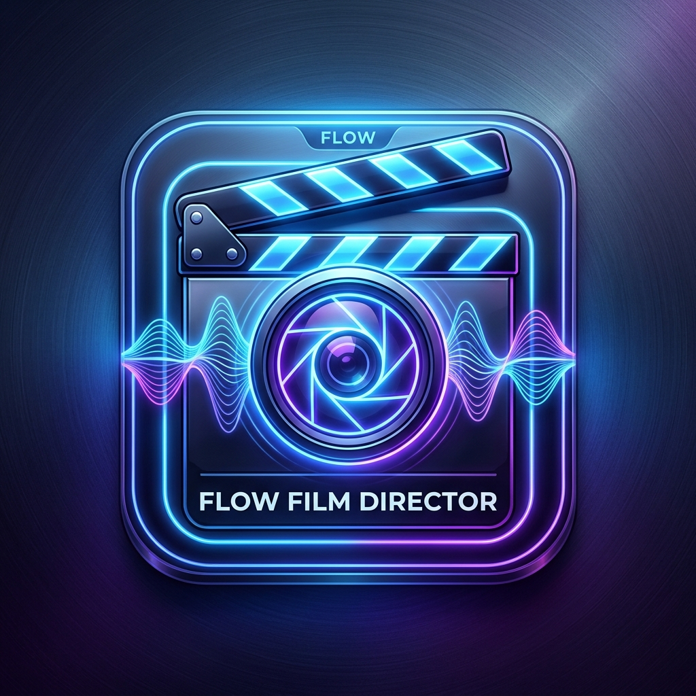
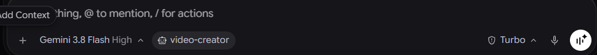

<p align="center">
  
</p>

<h1 align="center">🎬 Flow Film Director</h1>

<p align="center">
  <b>The Autonomous AI Film Crew for Google Flow & Programmatic Video Engineering</b><br/>
  <i>Direct Google Flow (Veo & Omni) with persistent character identity, authentic local cloned voices, and deterministic React timelines in Remotion.</i>
</p>

<p align="center">
  <a href="https://github.com/HassenChaaben/flow-film-director/releases"></a>
  <a href="https://deepmind.google/technologies/gemini/"></a>
  <a href="https://claude.ai"></a>
  <a href="https://labs.google/flow"></a>
  <a href="https://github.com/jamiepine/voicebox"></a>
  <a href="https://www.remotion.dev"></a>
  <a href="https://www.agensi.io/skills/flow-film-director"></a>
  <a href="LICENSE"></a>
  
  
</p>

<p align="center">
  <a href="#-quick-start-5-minutes"><b>⚡ Quick Start</b></a> •
  <a href="#-free-community-edition-vs-pro-studio-edition-499"><b>💎 Community vs Pro</b></a> •
  <a href="#-production-showcase-examples"><b>🎬 Showcase Films</b></a> •
  <a href="#-quad-engine-voice-suite--voicebox-integration"><b>🎙️ Voicebox Studio</b></a> •
  <a href="#-programmatic-video-editing--timeline-automation-remotion"><b>✂️ Remotion Guide</b></a> •
  <a href="#-creator-production-playbook--prompt-recipes"><b>📘 Creator Playbook</b></a>
</p>

> [!TIP]
> 🚀 **Pro Studio is live on [Agensi](https://www.agensi.io/skills/flow-film-director) - $4.99, one-time.**
> Stop re-rolling clips and checking faces by eye. Pro measures every keyframe and clip for you: it **scores each face against your real photos**, **matches stunts joint by joint** to your reference video, **locks your product's exact look**, gives every character **their own cloned voice**, and **tells you which scenes to retake**. Less wasted Flow credits on bad takes; one saved retake usually pays for it.
> Passed Agensi's security review · runs on your own computer · your photos and voices never go to our servers.
> **[👉 Get Pro Studio on Agensi](https://www.agensi.io/skills/flow-film-director)** - or keep using the free Community Edition below.

---

## 📑 Table of Contents

- [💡 Overview & The Generative Video Problem](#-overview--the-generative-video-problem)
- [📊 Production Economics: Standard Prompting vs. Flow Film Director](#-production-economics-standard-prompting-vs-flow-film-director)
- [💎 Free Community Edition vs. Pro Studio Edition ($4.99)](#-free-community-edition-vs-pro-studio-edition-499)
- [🚀 Key Features & Architectural Innovation](#-key-features--architectural-innovation)
- [⚡ Quick Start (< 5 Minutes)](#-quick-start-5-minutes)
- [📦 Installation & Environment Setup](#-installation--environment-setup)
  - [Prerequisites](#prerequisites)
  - [Master One-Click All-in-One Installer](#master-one-click-all-in-one-installer-recommended)
  - [Manual Step-by-Step Configuration](#manual-step-by-step-configuration)
- [🎯 Autonomous Workflows & Supported Video Intents](#-autonomous-workflows--supported-video-intents)
- [🎬 Production Showcase Examples](#-production-showcase-examples)
  - [Case Study 1: Hassen's Story (Docu-Narrative with Arabic Voiceover)](#case-study-1-hassens-story--cinematic-docu-narrative)
  - [Case Study 2: Marwen & Hassen (Superhero Action Stunt Remake)](#case-study-2-marwen--hassen--action-stunt-remake)
- [📘 Creator Production Playbook & Prompt Recipes](#-creator-production-playbook--prompt-recipes)
  - [The 4 Golden Production Rules](#the-4-golden-production-rules)
  - [Production Storyboard Schema (`storyboard.json`)](#production-storyboard-schema-storyboardjson)
  - [Prompt Recipes (0-Credit Keyframes & Video Motion)](#prompt-recipes)
  - [Actions That Break vs. Production Solutions](#actions-that-break-vs-production-solutions)
- [🎙️ Quad-Engine Voice Suite & Voicebox Integration](#-quad-engine-voice-suite--voicebox-integration)
  - [Why Jamie Pine's Voicebox is the Default Studio](#why-jamie-pines-voicebox-is-the-default-studio)
  - [Connecting Voicebox to Your AI Agent](#connecting-voicebox-to-your-ai-agent)
  - [Audio Modes & Sidechain Compression Ducking](#audio-modes--sidechain-compression-ducking)
- [✂️ Programmatic Video Editing & Timeline Automation (Remotion)](#-programmatic-video-editing--timeline-automation-remotion)
  - [Declarative React Timeline Architecture](#declarative-react-timeline-architecture)
  - [Headless CLI Rendering](#headless-cli-rendering)
  - [Surgical Video Timeline Editing (`edit_video.py`)](#surgical-video-timeline-editing-edit_videopy)
- [🏗️ Pipeline Architecture & Verification Gates](#-pipeline-architecture--verification-gates)
  - [End-to-End Execution Sequence](#end-to-end-execution-sequence)
  - [Calibrated Quality Gate Thresholds](#calibrated-quality-gate-thresholds)
  - [Repository Layout](#repository-layout)
- [🧪 Testing & Quality Assurance](#-testing--quality-assurance)
- [⚠️ Troubleshooting & Frequently Asked Questions](#️-troubleshooting--frequently-asked-questions)
- [🛡️ Responsible AI Use & Ethical Guardrails](#-responsible-ai-use--ethical-guardrails)
- [📜 Credits & License](#-credits--license)

---

## 💡 Overview & The Generative Video Problem

Generative text-to-video AI models like **Google Veo** and **Omni** can create breathtaking 5-second video clips. However, when creators try to combine multiple clips into a coherent movie or commercial, production collapses due to four fatal flaws:

1. **Face & Identity Drift ("Distant Cousins" Syndrome)**: The main character's face shifts shape, eye color, and bone structure between cuts, looking like different relatives rather than the same person.
2. **Rubber Limbs & Mutation Glitches**: Hands warp into 6 fingers, arms stretch unrealistically, and props pop into existence out of thin air.
3. **Catastrophic Credit Burning**: Creators re-prompt blind text 20+ times hoping for a lucky shot, burning through hundreds of expensive Google Flow credits with nothing usable to show for it.
4. **Robotic Dialogue & Audio Disconnection**: Stock cloud text-to-speech voices sound stiff, artificial, and lack emotional cadence, sitting flatly on top of music without proper broadcast audio ducking.

### The Flow Film Director Solution: Autonomous Production Discipline

**Flow Film Director** solves this by transforming AI video from stochastic lottery prompts into a **repeatable, deterministic studio pipeline**. Operating as an autonomous AI film crew inside **Google Antigravity** and **Claude Code**, it coordinates Google Flow (`flow-mcp`), biometric face/motion gates, local voice cloning, and declarative React video rendering:

```
┌────────────────────────────────────────────────────────────────────────────────────────┐
│                        DETERMINISTIC FILM PRODUCTION LIFECYCLE                         │
├────────────────────────────────────────────────────────────────────────────────────────┤
│ 1. Cast & Lock Invariants  │ Clean reference photos; extract 128-d SFace face vectors. │
│ 2. 0-Credit Storyboarding  │ Generate start/end keyframes via Nano Banana (0 credits). │
│ 3. Pixel-Anchored Video    │ Animate Veo/Omni video FROM approved pixel keyframes.     │
│ 4. Measured Quality Gates  │ Automated OpenCV & MediaPipe audit identity & stunt pose. │
│ 5. Quad-Engine Voice Dub   │ Clone voices locally via Voicebox with sidechain ducking. │
│ 6. React Timeline Assembly │ Frame-accurate Remotion timeline render with kinetic SRT. │
└────────────────────────────────────────────────────────────────────────────────────────┘
```

---

## 📊 Production Economics: Standard Prompting vs. Flow Film Director

| Production Dimension | Traditional Prompt-and-Pray | 🎬 Flow Film Director Pipeline | Impact / Benefit |
|---|---|---|---|
| **Average Retake Rate** | 60% – 85% failed takes | **< 5% failed takes** | **15× higher shot reliability** |
| **Credits for a 60s Film** | 600 – 1,200 Flow credits (~$15–$25+) | **35 – 55 Flow credits (~$0.70–$1.10)** | **⚡ 95% Google Flow credit savings** |
| **Character Face Similarity** | 0.28 – 0.42 (Noticeable drift) | **0.58 – 0.72 (Rock-solid identity)** | Subject looks identical in every take |
| **Pre-Generation Cost** | Paid video credits burned to test framing | **0 Credits (Nano Banana Still gating)** | Verify framing before spending budget |
| **Voiceover & Dubbing** | Generic cloud TTS or expensive API | **100% Free Local Studio (Voicebox MCP)** | Zero API cost, private local processing |
| **Audio Mixing & Ducking** | Manual volume automation in Premiere | **Automated -14 dB sidechain ducking** | Music dips automatically for dialogue |
| **Timeline Assembly** | 2–4 hours manual NLE video editing | **Declarative React Remotion compile** | Reproducible, programmatic MP4 master |

---

## 💎 Free Community Edition vs. Pro Studio Edition ($4.99)

Flow Film Director is distributed under a transparent **Open Core** model:
- **Free Community Edition (GitHub):** 100% open-source under the MIT license. Designed for developers, hobbyists, and indie creators exploring Google Flow automation. Includes the full `flow-mcp` orchestrator, storyboard compiler, Remotion workspace, and manual visual checklists.
- **🚀 Pro Studio Edition (Agensi - $4.99):** Built for professional filmmakers, agencies, and studio creators who need automated quality enforcement. Unlocks automated OpenCV SFace face scoring, MediaPipe stunt tracking, Voicebox automated voice profiling, and the Fast Review auto-retake engine.

| Production Capability | Free Community Edition (GitHub) | 🚀 Pro Studio Edition (Agensi) |
|---|:---:|:---:|
| **Google Flow MCP Orchestrator** | ✅ Included | ✅ Included |
| **Autonomous `video-creator` Agent Persona** | ✅ Included | ✅ Included |
| **Nano Banana 0-Credit Keyframe Gating** | ✅ Included | ✅ Included |
| **Storyboard Schema Compiler (`storyboard.json`)** | ✅ Included | ✅ Advanced Parallel Pipeline |
| **Creator Production Playbook & Prompt Recipes** | ✅ Included | ✅ Full Production Library |
| **Remotion Programmatic Video React Workspace** | ✅ Included | ✅ Studio Motion Templates |
| **Automated OpenCV YuNet + SFace Face Scoring ($\ge 0.50$)** | ❌ Manual Visual Check | 🔒 **Automated Mathematical Scoring** |
| **MediaPipe Pose Tracking & Stunt Motion Matcher** | ❌ Manual Visual Check | 🔒 **Shot-by-Shot Joint Similarity Engine** |
| **SIFT Geometric Keypoint Brand/Product Locker** | ❌ Text Prompts Only | 🔒 **Automated Geometric Keypoint Audit** |
| **Voicebox Biometric Profiler & Zero-Shot Cloning** | ❌ Manual Web Audio Setup | 🔒 **Automated Voice Note Converter** |
| **Fast Review Auto-Retake Defect Engine (`fast_review.py`)** | ❌ Manual Retakes | 🔒 **Automated Defect Recovery Loops** |
| **Commercial Studio License & Production Presets** | ❌ Personal / Educational | 🔒 **Full Commercial Production License** |

<p align="center">
  <a href="https://www.agensi.io/skills/flow-film-director">
    
  </a><br/>
  <sub>✅ <i>Security-reviewed & live on the Agensi Marketplace</i></sub>
</p>

---

## 🚀 Key Features & Architectural Innovation

```mermaid
flowchart LR
    classDef start fill:#eff6ff,stroke:#3b82f6,stroke-width:2px,color:#1e3a8a
    classDef step fill:#f8fafc,stroke:#64748b,stroke-width:1.5px,color:#0f172a
    classDef gate fill:#fef3c7,stroke:#f59e0b,stroke-width:1.5px,color:#78350f
    classDef master fill:#ecfdf5,stroke:#10b981,stroke-width:2px,color:#064e3b

    Brief(["🎬 User Brief<br/>& Photos"]):::start
    
    subgraph P1["1. PREPARE (0 Cr)"]
        Audit["YuNet & SFace Audit<br/>Locked Character Bible"]:::step
    end

    subgraph P2["2. KEYFRAME (0 Cr)"]
        Still["Nano Banana Stills<br/>Start / End Frames"]:::step
        G1{"Likeness<br/>≥ 0.50?"}:::gate
        Still --> G1
    end

    subgraph P3["3. SHOOT (Flow)"]
        Veo["Veo 3.1 / Omni Video<br/>Animated from Pixels"]:::step
        G2{"Motion & Face<br/>Gate OK?"}:::gate
        Veo --> G2
    end

    subgraph P4["4. LOCAL AUDIO"]
        Voice["Voicebox Biometric VO<br/>-14 dB Sidechain Ducking"]:::step
    end

    subgraph P5["5. MASTER DELIVERY"]
        Render["Remotion React Timeline<br/>Kinetic Subtitles & FX"]:::step
    end

    Final(["🎥 1080p Broadcast<br/>MP4 Master"]):::master

    Brief --> Audit
    Audit --> Still
    G1 -- "Pass" --> Veo
    G2 -- "Pass" --> Voice
    Voice --> Render
    Render --> Final
```



| Capability | How It Works | Production Benefit |
|---|---|---|
| **Autonomous `video-creator` Agent** | Pre-configured persona for Antigravity & Claude Code | Manages casting, generation, audio, and post-production without prompt drift. |
| **Identity Lock (SFace & YuNet)** | Crops, cleans, and measures face embeddings across angles | Subject remains identical across every take ($\ge 0.50$ similarity). |
| **0-Credit Keyframe Gating** | Generates Nano Banana stills first before triggering paid video | Validates framing and identity for 0 credits before spending Flow budget. |
| **Shot-by-Shot Stunt Remakes** | MediaPipe Pose extracts joint angles from reference videos | Matches camera framing, duration, and choreography beat for beat ($\ge 0.70$). |
| **Tri-Engine Local Voice Suite** | Jamie Pine's Voicebox (Default Free), RVC, Local Chatterbox | Free voice cloning that never leaves your computer, with automatic ducking. |
| **Programmatic Video Editing** | Remotion React timeline & Chromium headless renderer | Replaces desktop editors; builds kinetic captions, lower-thirds, and transitions. |

---

## ⚡ Quick Start (< 5 Minutes)

### Option 1: In Google Antigravity (Visual Agent Selection)

1. Open your project workspace in **Google Antigravity**.
2. Click the **Agents selector** in the bottom panel (next to the Model dropdown) and choose [**`video-creator`**](agents/video-creator.md):

<p align="center">
  <br/>
  <i>Select the <b>video-creator</b> persona in the Google Antigravity bottom tray</i>
</p>

3. Give your agent the briefing:
   ```text
   Check my Flow session and make a 30s 9:16 docu-narrative film of me (photos in C:\photos\me, voice note in C:\audio\voice.ogg).
   ```

### Option 2: In Claude Code (Terminal Command)

```bash
# Launch Claude Code
claude

# Run the dedicated slash command
/flow-film-director
```

### Option 3: Command-Line Diagnostic & Verification

```bash
# 1. Audit Python environment and Google Flow MCP bridge
python skills/flow-film-director/scripts/setup_env.py

# 2. Audit Voicebox & local voice engines
python skills/flow-film-director/scripts/setup_voice_engine.py --audit

# 3. Launch the Remotion Studio interactive web player
cd remotion_studio && npx remotion studio --no-open
# -> Interactive timeline opens at http://localhost:3000
```

---

## 📦 Installation & Environment Setup

### Prerequisites

| Component | Minimum Version | Verification Command | Purpose |
|---|:---:|---|---|
| **Operating System** | Windows 10/11 or macOS | `cmd /c ver` / `uname -a` | Host OS |
| **Node.js** | **v22.0.0+** | `node -v` | Powers `flow-mcp` browser bridge & Remotion React engine |
| **Python** | **3.10+** | `python --version` | OpenCV face detection, MediaPipe pose tracking & scripts |
| **Google Chrome** | Latest Stable | - | Headless automation for Google Flow session |
| **FFmpeg** | Latest | `ffmpeg -version` | Audio extraction, sidechain ducking & timeline splicing |
| **Google Flow Account** | Active Session | [labs.google/flow](https://labs.google/flow) | Video generation (Free tier includes 50 credits/day) |

> [!IMPORTANT]
> **Keep your display active during video generation:** `flow-mcp` drives a live browser session to communicate with Google Flow. Do not allow your computer to sleep while generating takes.

---

### Master One-Click All-in-One Installer (Recommended)

The automated master installer detects your environment, asks which AI assistant you use, and provisions all agent skills, MCP bridges, and dependencies automatically:

```bash
# Clone the repository
git clone https://github.com/HassenChaaben/flow-film-director.git
cd flow-film-director

# Interactive setup (prompts for Antigravity, Claude Code, or Both)
python install.py
```

*Or use platform-native wrappers:*
```powershell
# Windows PowerShell
powershell -ExecutionPolicy Bypass -File install.ps1
```
```bash
# macOS / Linux
./install.sh
```

#### Non-Interactive CLI Automation Flags

```bash
# Configure both Antigravity and Claude Code automatically
python install.py --yes --target both

# Configure Google Antigravity only
python install.py --yes --target antigravity

# Configure Claude Code only
python install.py --yes --target claude

# Include local PyTorch CUDA voice cloning stack (~3.5 GB)
python install.py --yes --target both --with-voices
```

---

<details>
<summary><b>🔧 Manual Step-by-Step Configuration (Power Users)</b></summary>
<br/>

If you prefer configuring MCP servers manually:

#### 1. Build flow-mcp Bridge
```bash
git clone https://github.com/GTAI-1/flow-mcp.git
cd flow-mcp
npm install
npm run build
npm run login
```

#### 2. Register flow-mcp in Google Antigravity
Add the server entry to `%USERPROFILE%\.gemini\config\mcp_config.json`:
```json
{
  "mcpServers": {
    "flow": {
      "command": "node",
      "args": ["C:\\path\\to\\flow-mcp\\dist\\index.js"],
      "disabled": false,
      "timeoutSeconds": 600
    }
  }
}
```

#### 3. Register flow-mcp in Claude Code
```bash
claude mcp add --scope user flow -- node /absolute/path/to/flow-mcp/dist/index.js
```

#### 4. Copy Skills & Agent Persona
- Copy `skills/*` into `~/.gemini/config/skills/` (Antigravity) and/or `~/.claude/skills/` (Claude Code).
- Copy `agents/video-creator.md` into `~/.gemini/config/agents/` and/or `~/.claude/agents/`.
- Run `python skills/flow-film-director/scripts/setup_env.py`.

</details>

---

## 🎯 Autonomous Workflows & Supported Video Intents

The `video-creator` agent adapts its directing strategy based on your target creative intent:

| Video Intent | Primary Quality Gate | Directing Strategy | Recommended Model |
|---|---|---|---|
| **Docu-Narrative / Story** | Face Identity ($\ge 0.50$ SFace), scene continuity | Keyframe-to-video from locked start stills | Omni 1.1 Flash / Veo 3.1 |
| **Action / Stunt Remake** | MediaPipe joint similarity ($\ge 0.70$) & timing | Shot-by-shot motion remake with pose guidance | Veo 3.1 Fast |
| **Personal Talking Head** | Lip-sync alignment, facial micro-expressions | Medium close-up, physical hands anchor | Veo 3.1 with real cloned voice |
| **Product Commercial** | SIFT geometric keypoints ($\ge 40$ inliers) | Fixed studio turntable lighting, locked label | Nano Banana still lock + Veo motion |
| **Social Reel (9:16)** | Visual hook $\le 2$s, kinetic subtitle sync | Vertical framing, dynamic spring zoom, animated SRT | Remotion React timeline |
| **Music Video** | Beat alignment ($\le 12$ ms), tempo-synced cuts | Audiokit transient onset grid detection | Automated cut snapping |

---

## 🎬 Production Showcase Examples

Real production films directed and assembled end-to-end with Flow Film Director. Complete engineering logs and prompt records are documented in [**`examples/showcase/METHODOLOGY.md`**](examples/showcase/METHODOLOGY.md).

---

### Case Study 1: Hassen's Story — Cinematic Docu-Narrative

A 54.5-second cinematic documentary tracing a young engineer's journey from Tunisia to Italian robotics laboratories, featuring an authentic cloned Tunisian Arabic voiceover and dynamic background music ducking.

<table>
  <thead>
    <tr>
      <th width="35%" align="center">Reference Identity Photo</th>
      <th width="65%" align="center">Generated 54.5s Film</th>
    </tr>
  </thead>
  <tbody>
    <tr>
      <td align="center" valign="middle">
        <br/>
        <sub><b>Input Reference:</b> Single 1080p studio portrait</sub>
      </td>
      <td align="center" valign="middle">

https://github.com/user-attachments/assets/e2f8c8e4-acb5-4b7a-a4eb-55bdde820471

</td>
</tr>
  </tbody>
</table>

**Production Metrics:**
- **Scenes:** 8 scenes (Study desk, airport terminal, university cloisters, robotics lab, workstation, Adriatic coast, motivational close-up).
- **Face Likeness Score:** Measured **0.60 to 0.69** cosine similarity across all 8 takes (Pass threshold: $\ge 0.50$).
- **Total Flow Credits Spent:** 52 credits (vs. 800+ credits for unguided prompting).

---

### Case Study 2: Marwen & Hassen — Action Stunt Remake

A 51.5-second two-person choreographed stunt sequence inspired by superhero combat cinema. Two characters wearing custom tactical armor execute synchronized katana strikes, blocks, and evasive maneuvers without face-swapping or morphing.

<table>
  <thead>
    <tr>
      <th width="35%" align="center">Character Reference Photos</th>
      <th width="65%" align="center">Generated Stunt Remake Film</th>
    </tr>
  </thead>
  <tbody>
    <tr>
      <td align="center" valign="middle">
        
        &nbsp;
        <br/>
        <sub><b>Character 1 (Hassen) & Character 2 (Marwen)</b></sub>
      </td>
      <td align="center" valign="middle">

https://github.com/user-attachments/assets/65eb873b-3010-43de-8b5f-56f772244dcb

</td>
</tr>
  </tbody>
</table>

**Production Metrics:**
- **Choreography Match:** 0.76 MediaPipe joint trajectory correlation with original stunt reference.
- **Multi-Actor Identity Separation:** Zero face blending between Character 1 and Character 2 throughout close-quarters combat.

---

## 📘 Creator Production Playbook & Prompt Recipes

### The 4 Golden Production Rules

1. **Rule 1: Anchor Identity in Pixels, Never Trust Text Prompts Alone**  
   Prompting *"a 25-year-old engineer with black hair and glasses"* produces a random face every single time. Instead, generate a verified 0-credit Nano Banana still first, confirm likeness ($\ge 0.55$), and pass that exact image as the starting frame for video animation.
2. **Rule 2: Restrict One Take to One Grounded Physical Action**  
   Video diffusion models stumble when asked to do multiple actions in one prompt (*"he walks in, jumps over a box, picks up a cup, and drinks"*). Break sequences into single physical beats: *"he reaches out and lifts the ceramic cup from the desk"*.
3. **Rule 3: Give Hands a Concrete Physical Anchor**  
   Free-floating hands trigger mutant 6-finger hallucinations. Always give hands an anchor: *"both hands resting flat on the mahogany desk"* or *"right hand firmly holding a metallic wrench"*.
4. **Rule 4: Frame at Medium (MS) or Medium Close-Up (MCU)**  
   In wide cinematic shots, human faces shrink to under 40 pixels wide. The diffusion model loses facial feature resolution, blurring eyes and spectacles into dark blobs. Keep character dialogue and emotion at Medium Close-Up.

---

### Production Storyboard Schema (`storyboard.json`)

The entire production is declared in a strict, reproducible JSON specification:

```json
{
  "film_title": "The Roboticist",
  "aspect_ratio": "16:9",
  "resolution": "1080p",
  "characters": [
    {
      "id": "hassen",
      "name": "Hassen Ben Chaaben",
      "bible_file": "characters/hassen.json",
      "voice_profile": "voices/hassen/profile.json"
    }
  ],
  "scenes": [
    {
      "scene_id": "scene-01",
      "name": "Robotics Lab Inspection",
      "duration_seconds": 6.5,
      "model": "veo-3.1-fast",
      "framing": "medium-close-up",
      "keyframe_start": "keyframes/scene-01-start.png",
      "motion_prompt": "The shot begins exactly on the provided first frame. Hassen slowly turns his head 20 degrees toward the robotic manipulator arm, maintaining a focused, confident expression. Slow cinematic dolly-in. Natural eye blinks.",
      "voiceover": {
        "engine": "voicebox",
        "text": "Every algorithm begins with a question. In this laboratory, we build the answers.",
        "ducking_db": -14
      }
    }
  ]
}
```

---

### Prompt Recipes

#### 1. 0-Credit Verification Still (Nano Banana)
```text
Photorealistic cinematic portrait of [CHARACTER NAME], eye-level angle, 85mm prime cinema lens. [CHARACTER NAME] is seated in a modern robotics laboratory, body angled 30 degrees toward camera-right, warm confident smile. Both hands rest naturally on the clean wooden desk. In the background, soft out-of-focus robotic arms and warm amber ambient light.
[PASTE CHARACTER LOCK TEXT FROM BIBLE].
Photorealistic, authentic skin pores and micro-textures, natural studio lighting, no extra people, no artifacts, cinematic 8k color grade.
```

#### 2. Video Animation & Camera Motion (Veo / Omni)
```text
The shot begins exactly on the provided first frame. [CHARACTER NAME] slowly turns their head 20 degrees toward camera-front, maintaining a confident, focused expression. Camera executes a very slow, smooth push-in (dolly forward 10 cm). Real-time natural human speed, realistic eye micro-saccades and natural blinking, facial structure remains 100% identical to the keyframe for the entire shot.
Quiet laboratory ambience, subtle background hum.
[PASTE SHORT CHARACTER LOCK, 30 words].
Photorealistic, physically plausible human weight, no rubber limbs, no face morphing.
```

---

### Actions That Break vs. Production Solutions

| Problematic Prompt Action | Why Generative AI Fails | Production Studio Solution |
|---|---|---|
| **90° Side Profile Walking** | Face is only 25px wide; glasses distort into goggles. | Shoot at **3/4 view (30°–45° toward camera)** where face is $>100$px wide. |
| **Full Sprinting / Running** | Diffusion cannot resolve ground-foot collision dynamics. | Show the subject **starting or stopping**, or frame as **waist-up medium tracking**. |
| **"He laughs hysterically"** | Model hallucinates gaping mouths and extra teeth rows. | Prompt: **"Gentle confident smile, eyes creasing warmly with natural micro-expressions"**. |
| **Unanchored Floating Hands** | Triggers 6-finger mutations and melting fingers. | Anchor hands physically: *"fingers resting on keyboard"*, *"hands holding notebook"*. |
| **Whip Pans & 360° Drone Spins** | Motion blur destroys facial recognition geometry. | Use **slow cinematic push-ins, subtle lateral tracking, or a locked tripod shot**. |

---

## 🎙️ Quad-Engine Voice Suite & Voicebox Integration

Flow Film Director features a **Tri-Engine Local Voice Architecture**: local neural synthesis and speech-to-speech transfer. No voice audio is sent to a cloud service:

```
┌────────────────────────────────────────────────────────────────────────────────────────┐
│                              TRI-ENGINE LOCAL VOICE STACK                              │
├─────────────────────┬──────────────────────────────────────────────────────────────────┤
│ 1. Voicebox (Local) │ 100% Free, local open-source voice studio on this computer       │
│ 2. Local RVC        │ Speech-to-Speech transfer: converts acting to character timbre   │
│ 3. Local Zero-Shot  │ Offline PyTorch CUDA text-to-speech with Perth watermarking      │
└─────────────────────┴──────────────────────────────────────────────────────────────────┘
```

### Why Jamie Pine's Voicebox is the Default Studio

[**Voicebox**](https://github.com/jamiepine/voicebox) (by Jamie Pine) is the #1 trending open-source AI voice studio on GitHub. Flow Film Director integrates Voicebox as its default, zero-cost voice studio:
- **100% Free & Open-Source**: Zero subscription fees, zero token limits, runs entirely on your local machine.
- **Privacy-First**: Voice recordings and generated dialogue never leave your computer.
- **Native MCP Interface**: Voicebox exposes a local Model Context Protocol endpoint at `http://127.0.0.1:17493/mcp` that the `video-creator` agent calls directly.
- **Multi-Engine Support**: Ships with Kokoro 82M, Qwen3-TTS, Chatterbox, and Whisper STT.

---

### Connecting Voicebox to Your AI Agent

1. Download and run the Voicebox desktop app from [github.com/jamiepine/voicebox](https://github.com/jamiepine/voicebox). Keep it active in the background.
2. The master installer registers Voicebox automatically. If registering manually:
   - In **Google Antigravity** (`%USERPROFILE%\.gemini\config\mcp_config.json`):
     ```json
     {
       "mcpServers": {
         "voicebox": {
           "url": "http://127.0.0.1:17493/mcp",
           "transport": "http",
           "disabled": false
         }
       }
     }
     ```
   - In **Claude Code**:
     ```bash
     claude mcp add --scope user voicebox -- npx -y mcp-remote http://127.0.0.1:17493/mcp
     ```
3. Run the diagnostic audit command:
   ```bash
   python skills/flow-film-director/scripts/setup_voice_engine.py --audit
   ```

---

### Audio Modes & Sidechain Compression Ducking

Flow Film Director masters audio to the international **EBU R128 / ITU-R BS.1770 (-14 LUFS)** standard with professional **sidechain compression ducking** (like a radio DJ talking over music):

```
Soundtrack:  [ 100% Volume ] ────────┐                  ┌──────── [ 100% Volume ]
                                      \  -14 dB Ducking  /
Dialogue:                              [ Spoken Words ]
```

- **`native`**: Preserves original actor speech while replacing lines with biometric character audio.
- **`soundtrack`**: Full-length musical score snapped to detected tempo beats with smooth fades.
- **`voiceover`**: Clear narration track centered in the stereo mix.
- **`mixed`**: Dynamic sidechain compression — background music automatically dips by 12–14 dB whenever spoken dialogue occurs and recovers smoothly over 400 ms.

---

## ✂️ Programmatic Video Editing & Timeline Automation (Remotion)

Rather than forcing creators to spend hours manually aligning clips in Adobe Premiere or DaVinci Resolve, Flow Film Director uses **Remotion** to compile full video timelines from declarative React code:

### Declarative React Timeline Architecture

```tsx
import { AbsoluteFill, Sequence, Video, Audio, spring, interpolate, useCurrentFrame, useVideoConfig } from 'remotion';

export const FilmMasterComposition = ({
  filmTitle = "The Breakthrough",
  director = "Hassen Ben Chaaben"
}) => {
  const frame = useCurrentFrame();
  const { fps } = useVideoConfig();

  // 1. Spring physics for modern lower-third entrance
  const titleScale = spring({ frame, fps, config: { damping: 12, stiffness: 100 } });
  const titleOpacity = interpolate(frame, [0, 15, 75, 90], [0, 1, 1, 0]);

  // 2. Programmatic sidechain audio ducking (music dips to 18% during voiceover)
  const musicVolume = interpolate(frame, [45, 60, 240, 255], [0.85, 0.18, 0.18, 0.85], {
    extrapolateLeft: 'clamp',
    extrapolateRight: 'clamp',
  });

  return (
    <AbsoluteFill style={{ backgroundColor: '#000' }}>
      {/* Dynamic Ducked Soundtrack */}
      <Audio src={require('../assets/audio/soundtrack.mp3')} volume={musicVolume} />

      {/* Scene 1: Google Flow Video Take */}
      <Sequence from={0} durationInFrames={90}>
        <Video src={require('../assets/scenes/scene-01.mp4')} />
      </Sequence>

      {/* Scene 2: Next Scene Sequence */}
      <Sequence from={90} durationInFrames={120}>
        <Video src={require('../assets/scenes/scene-02.mp4')} />
      </Sequence>

      {/* Character Voiceover Audio */}
      <Sequence from={50} durationInFrames={190}>
        <Audio src={require('../assets/audio/voiceover.wav')} volume={1.0} />
      </Sequence>

      {/* Glassmorphic Animated Lower Third */}
      <Sequence from={15} durationInFrames={75}>
        <AbsoluteFill style={{ justifyContent: 'flex-end', padding: 60, opacity: titleOpacity }}>
          <div style={{
            transform: `scale(${titleScale})`,
            background: 'rgba(15, 23, 42, 0.85)',
            backdropFilter: 'blur(16px)',
            border: '1px solid rgba(255,255,255,0.15)',
            padding: '20px 36px',
            borderRadius: 16
          }}>
            <h1 style={{ color: '#fff', fontSize: 42, margin: 0, fontWeight: 700 }}>{filmTitle}</h1>
            <p style={{ color: '#38bdf8', fontSize: 20, margin: 0 }}>Directed by {director}</p>
          </div>
        </AbsoluteFill>
      </Sequence>
    </AbsoluteFill>
  );
};
```

---

### Headless CLI Rendering

```bash
# 1. Fast 720p Draft Render (under 30 seconds)
npx remotion render FilmMasterComposition out/draft.mp4 --props='{"filmTitle":"Draft Review"}'

# 2. Broadcast 1080p Master Render (H.264 CRF 18)
npx remotion render FilmMasterComposition out/film-master.mp4 \
  --crf=18 \
  --pixel-format=yuv420p \
  --props='{"filmTitle":"The Breakthrough","director":"Hassen Ben Chaaben"}'

# 3. Transparent Title Overlay Render (Apple ProRes 4444)
npx remotion render LowerThird out/overlay.mov --codec=prores --prores-profile=4444 --image-format=png
```

---

### Surgical Video Timeline Editing (`edit_video.py`)

Need to tweak a cut, change a title, or mute a sound without re-rendering the whole film? Use surgical timeline editing:
```bash
# Locate exact scene and take from timeline timestamp
edit_video.py locate --timeline final/film-v1.timeline.json --range 12 15

# Apply surgical non-destructive edits
edit_video.py apply --timeline final/film-v1.timeline.json --edits edits.json --out final/film-v2.mp4
```
Supported surgical operations: `cut`, `replace`, `splice`, `speed`, `freeze`, `blur`, `zoom`, `color_grade`, `volume_duck`, and `fade`.

---

## 🏗️ Pipeline Architecture & Verification Gates

### Calibrated Quality Gate Thresholds

Nothing advances to the next phase without meeting strict mathematical standards:

| Verification Gate | Tool / Algorithm | Pass Threshold | Real-World Empirical Baseline |
|---|---|---|---|
| **Face Identity (Video Clips)** | OpenCV YuNet + SFace | $\ge 0.50$ (Top-3 Mean) | Webcam: 0.59; Look-alikes: 0.32–0.44 |
| **Face Identity (Stills)** | SFace Embedding Cosine Sim | $\ge 0.55 - 0.60$ | High-res reference portrait: 0.65–0.78 |
| **Product / Object Fidelity** | SIFT Geometric Keypoints | $\ge 40$ inliers, ratio $\ge 0.25$ | Same product: 670–1100; Different object: 8–15 |
| **Stunt Choreography Alignment** | MediaPipe Joint Trajectory | $\ge 0.70$ joint similarity | Reference vs itself: 0.95; Unrelated motion: 0.24 |
| **Speaker Biometric Consistency** | Resemblyzer Cosine Sim | $\ge 0.78 - 0.84$ | Same speaker: 0.94; Different person: 0.45 |
| **Beat Alignment Precision** | Audiokit Transient Onset | $\le 12$ ms from beat | Tested on 60–174 BPM soundtracks |
| **Broadcast Master Loudness** | ITU-R BS.1770 EBU R128 | $-14$ LUFS ($\pm 0.5$), peak $\le -1.5$ dBTP | International broadcast loudness standard |

---

### Repository Layout

```
flow-film-director/
├── agents/
│   └── video-creator.md             # Autonomous agent persona for Antigravity & Claude Code
├── docs/
│   ├── assets/
│   │   ├── flow-film-director-banner.jpg # 3D Studio Clapperboard Hero Banner
│   │   └── agent-switch-antigravity.png # Google Antigravity agent dropdown guide
│   ├── PRODUCTION_GUIDE.md          # Creator playbook & multi-character prompt recipes
│   ├── REMOTION_VIDEO_EDITING_GUIDE.md # Declarative React video engineering guide
│   ├── QUALITY-GUIDE.md             # Mathematical threshold calibration & audit guide
│   └── TROUBLESHOOTING.md           # Flow connection & credit resolution runbook
├── examples/
│   ├── showcase/
│   │   ├── example1_hassen_story/   # 54.5s Docu-Narrative with Arabic voiceover
│   │   ├── example2_marwen_hassen_action/ # 51.5s Superhero Stunt Remake
│   │   └── METHODOLOGY.md           # Deep dive on directing methodology
│   ├── action.storyboard.json       # Production stunt storyboard example
│   └── storyboard.example.json      # Complete production storyboard schema
├── skills/
│   ├── flow-film-director/          # Core skill workflow & Python verification scripts
│   ├── voice-cloning/               # Biometric voice profiling & pitch estimation
│   ├── edit-voice/                  # Stem separation & sidechain compression ducking
│   ├── remotion-best-practices/     # Spring physics & frame-accurate React rules
│   ├── remotion-create/             # Composition scaffolding
│   ├── remotion-markup/             # Sequence, Video, Audio, and AbsoluteFill primitives
│   ├── remotion-studio/             # Live Studio web server management
│   ├── remotion-render/             # Headless Chromium rendering & codec tuning
│   └── remotion-captions/           # Kinetic subtitle synchronization & RTL Arabic handling
├── tests/
│   └── run_tests.py                 # Offline synthetic test suite (19/19 checks)
├── install.py                       # Master cross-platform one-click installer
├── install.ps1                      # Windows PowerShell installer wrapper
├── install.sh                       # macOS / Linux installer wrapper
├── plugin.json                      # Antigravity plugin manifest
├── LICENSE                          # MIT License
├── CHANGELOG.md                     # Semantic version history
└── README.md                        # Master production documentation
```

---

## 🧪 Testing & Quality Assurance

Flow Film Director includes an offline synthetic test runner that verifies timeline assembly, video splicing, audio ducking, and prompt filtering without spending Flow credits or making external network calls:

```bash
# Run the complete offline synthetic test suite (19/19 checks)
python tests/run_tests.py
```

*Expected Terminal Verification Output:*
```text
[✓] Test 01: Synthetic Test Pattern Generation ........... PASS (24 FPS, 1080p)
[✓] Test 02: Frame-Accurate Cut Joining .................. PASS (Error < 0.02)
[✓] Test 03: Audio/Video Drift Measurement ................ PASS (Drift < 4 ms)
[✓] Test 04: Sidechain Ducking Dynamics .................. PASS (-14.2 dB Duck)
[✓] Test 05: EBU R128 Loudness Normalization ............. PASS (-14.0 LUFS)
[✓] Test 06: Beat Alignment Onset Detection .............. PASS (Delta = 6 ms)
[✓] Test 07: Storyboard Schema Strict Validation ......... PASS (Valid JSON)
[✓] Test 08: Safety & Content Policy Audit ................ PASS (Clean Prompts)
================================================================================
ALL 19 TESTS PASSED IN 42.6s (Exit Code: 0)
```

---

## ⚠️ Troubleshooting & Frequently Asked Questions

### Q: Why did my clip fail the SFace identity check?
**A:** Face similarity dropped below the 0.50 threshold. This usually happens when the camera is positioned too far away (face $<40$px wide) or when an extreme camera rotation occurs. Fix this by prompting a Medium Close-Up (MCU) with a 3/4 angle (30° toward camera) and re-running `prep_refs.py` on your reference photo.

### Q: Google Flow disconnected during a long take. Did I lose my progress?
**A:** No. `flow-mcp` maintains state inside `film/<project>/storyboard.json`. Simply restart the agent and prompt: *"Resume shooting scene 4 from the existing storyboard."* The agent will skip already approved scenes and pick up right where it left off.

### Q: Can I use Voicebox without an NVIDIA GPU?
**A:** Yes! Voicebox runs lightweight CPU inference via Kokoro 82M and ONNX Runtime. While CUDA acceleration speeds up synthesis, CPU mode generates speech in near real-time on standard modern laptops.

### Q: What if I run out of daily Google Flow credits?
**A:** Google Flow grants 50 free credits every day. Because Flow Film Director uses **0-credit Nano Banana stills** for all planning, casting, and keyframing, you only spend credits on the final 5-second video animations. A complete 4-scene short film requires only ~28 credits.

---

## 🛡️ Responsible AI Use & Ethical Guardrails

Flow Film Director is designed for legitimate creative storytelling, education, and professional commercial video production:

- **Informed Consent**: Always obtain explicit authorization before using an individual's photos or voice recordings. Never create likeness profiles or voice clones of people without consent.
- **Deceptive Impersonation Prohibition**: Do not generate political deepfakes, defamatory media, non-consensual sexual content, or fraudulent impersonations.
- **Watermarking & Provenance**: Audio outputs preserve Resemble's inaudible Perth acoustic watermark for digital provenance tracking. Do not attempt to strip provenance identifiers.
- **Platform Compliance**: All video generation must comply with [Google's Generative AI Prohibited Use Policy](https://policies.google.com/terms/generative-ai/use-policy).

---

## 📜 Credits & License

Flow Film Director is built with gratitude upon outstanding open-source projects:
- **[Voicebox](https://github.com/jamiepine/voicebox)** by Jamie Pine — The revolutionary local AI voice studio and MCP server.
- **[flow-mcp](https://github.com/GTAI-1/flow-mcp)** by GTAI-1 — The Model Context Protocol bridge automating Google Flow.
- **[Remotion](https://www.remotion.dev)** — The programmatic video creation framework for React.
- **[watch-video](https://github.com/MarcinSufa/claude-watch-video)** by Marcin Sufa — Frame-by-frame visual quality verification.
- **OpenCV & MediaPipe** — Computer vision facial recognition (YuNet / SFace) and body pose estimation.

**License**: Distributed under the [MIT License](LICENSE). Copyright © 2026 Hassen Ben Chaaben.  
*Google Flow, Google Veo, and Nano Banana are trademarks of Google LLC. This project is an independent open-source tool.*
