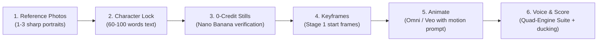

# The Creator's Guide: Production-Grade Personalized AI Videos

A practical, step-by-step playbook on turning real people, real products, and real voices into consistent, cinematic videos with Google Flow, Flow MCP, and the Flow Film Director agent.

---

## The 4 Golden Rules of AI Video Production

1. **AI video models have zero memory between takes.** Every prompt must explicitly contain: **Who** (Character Lock) + **Where** (Set & Lighting) + **What** (One physical action) + **Camera lens & move**.
2. **Never ask for complex multi-actions in a single shot.** An 8-second clip should depict **one single realistic physical action** (e.g. *reaching for a book*, *turning to look at a monitor*, *walking two slow steps*). Fast, frenetic motions cause rubber limbs and face melting.
3. **Always anchor with a Verified Start Keyframe.** In modern video generation (Omni / Veo), video initialized from pure text will drift and hallucinate. Passing a verified 0-credit first frame (`first_frame`) locks facial identity before the first camera shutter fires.
4. **Isolate Voice Stems Before Mixing.** Never run voice cloning on mixed video with background music. Clone or convert clean vocal stems, verify speaker similarity ($\ge 0.78$), and duck the music score with sidechain compression.

---

## Step-by-Step Production Workflow



---

## 1. Choosing & Cleaning Reference Photos

For best face identity, feed the agent **1 to 3 real photos**:
- **Photo 1 (Frontal)**: High-resolution, eye-level, neutral expression or gentle smile, face occupying at least 20% of frame height.
- **Photo 2 (3/4 Profile)**: 30° to 45° angle showing jawline, ear, and hair profile.
- **Photo 3 (Optional Action/Context)**: Sitting at a desk or working.

> **Clean Phone Screenshots First**: If uploading screenshots from Instagram, LinkedIn, or WhatsApp:
> ```bash
> python scripts/prep_refs.py "path/to/photos" --out "path/to/clean" --auto
> ```
> This strips battery bars, notch cutouts, chat bubbles, and icons that Flow would otherwise paint onto your actor's clothes!

---

## 2. Writing the Character Lock (The Identity DNA)

The Character Lock is a 60–100 word measured description that tells Flow how to render your person identically across every shot.

### Character Lock Formula
```
[Exact facial bone structure & skin tone] + [Eye color & specific glasses geometry] + [Exact hair texture, length in cm, and part] + [Specific wardrobe: garment, color, fabric] + [Negative anchors: no changes, no morphing]
```

### Real Example: Hassen's Character Lock
```text
Hassen is a North African man in his mid-20s with short natural dark curly hair about 3 cm on top with tapered sides, light warm olive skin, rectangular rounded clear-grey acetate eyeglasses with sharp non-glare lenses, warm brown eyes, clean-shaven jawline with subtle natural shadow, athletic build. He wears a clean fitted dark navy blazer over a crisp white cotton shirt. Consistent facial geometry across all angles.
```

### Real Example: Marwen's Character Lock
```text
Marwen is a North African man in his late 20s with neat dark hair styled back, expressive dark eyes, warm olive complexion, structured jawline with neatly trimmed stubble beard. He wears a tactical combat uniform with deep yellow and navy blue reinforced ballistic plating. Confident focused expression.
```

---

## 3. Production Prompt Recipes & Concrete Examples

### Template A: 0-Credit Verification Still (Phase 3)
*Used to confirm Flow draws your person with 100% facial accuracy on Google's free Nano Banana model before spending any video credits.*

```text
Head-and-shoulders portrait of [Name], eye-level angle, 85mm portrait lens, shallow depth of field. Soft studio key light from camera-left with gentle fill. Plain neutral light-grey backdrop. Sharp focus on iris and glasses frames. 
[PASTE CHARACTER LOCK].
Photorealistic, full-frame cinema sensor, natural skin texture with visible pores, real human facial anatomy, physically plausible, no cartoon, no CGI, no text, no watermark.
```

---

### Template B: Cinematic Start Keyframe (Phase 4)

#### Example 1: High-Tech Laboratory (From Hassen's Story)
```text
Medium shot of Hassen, eye-level angle, 50mm anamorphic cinema lens. Hassen is seated at a high-tech modern AI robotics engineering workstation, body angled slightly toward camera-left. His left hand rests naturally on the clean desk near an ergonomic mouse; his right hand is raised slightly in thoughtful concentration. He looks attentively at a vertical high-resolution code monitor displaying deep learning training loss curves. Behind him, a subtle robotic arm and clean laboratory glass partition with soft blue and amber ambient LEDs are visible. Soft cinematic volumetric sunlight streaming from camera-right.
[PASTE HASSEN CHARACTER LOCK].
Photorealistic, natural skin texture, authentic workspace details, no duplication, no extra people, cinematic color grade.
```

#### Example 2: Action / Superhero Combat Staging (From Marwen & Hassen Remake)
```text
Medium-wide two-shot, dynamic low-angle framing, 35mm wide lens. In the center-right of frame, Hassen stands in a combat-ready stance, wielding twin carbon-steel katana swords held downwards at his sides, wearing his red and black reinforced tactical suit with unmasked face clearly visible. To camera-left, Marwen stands shoulder-to-shoulder with him in blue and yellow ballistic battle armor, hands raised with tactical gauntlets. The setting is an urban cobblestone alleyway at dusk, wet pavement reflecting soft orange streetlights and misty blue atmospheric haze.
[PASTE HASSEN CHARACTER LOCK]. [PASTE MARWEN CHARACTER LOCK].
Hassen is the one with clear acetate glasses and red suit; Marwen is the one in yellow-and-blue armor with trimmed stubble.
Photorealistic cinema capture, natural cinematic motion blur, sharp focus on faces, zero face swapping, physically grounded stances.
```

---

### Template C: Video Animation & Camera Motion Prompts (Phase 5)

#### Example 1: Subtle Real-Time Action
```text
The shot begins exactly on the provided first frame. Hassen slowly turns his head 20 degrees from the monitor toward camera-front, a subtle confident smile appearing on his face as the code successfully executes. His hand stays grounded on the desk. Camera executes a very slow, smooth push-in (dolly forward 10 cm). Real-time natural human speed, realistic eye micro-saccades and natural blinking, faces remain identical to the keyframe for the entire shot.
Quiet robotics lab ambience, subtle keyboard click.
[PASTE SHORT CHARACTER LOCK, 30 words].
Photorealistic, physically plausible human weight, no rubber limbs, no face morphing.
```

#### Example 2: Choreographed Combat Sequence
```text
The shot begins exactly on the provided first frame. Hassen and Marwen simultaneously take one decisive step forward in synchronized combat choreography. Hassen swings his right katana in a controlled diagonal arc before settling into a defensive parry stance. Marwen steps into frame-left, raising his tactical gauntlet to block an off-screen impact. The camera tracks smoothly backward on a low dolly track at steady speed. Real-time cinematic speed, natural physical momentum and weight, both actors maintain their distinct facial identities and costumes throughout.
Impact whoosh, metallic blade resonance, tactical boot impact on wet stone.
[PASTE SHORT COMBINED LOCKS].
Photorealistic, zero face blending, no limb distortion.
```

---

## 4. Avoiding the 7 Common AI Video Mistakes

| Mistake | Why It Breaks | What To Do Instead |
|---|---|---|
| **90° Side Profile Walking** | Face is only 30px wide; eyeglasses warp into goggles. | Shoot at **3/4 view (30°–45° toward camera)** where face is >100px. |
| **Running or Sprinting** | AI cannot resolve complex feet/ground physics; creates sliding/skating legs. | Show the subject **starting or stopping**, or capture **upper-body medium shot** running. |
| **"He laughs hysterically"** | Model hallucinates gaping mouths, extra teeth, and warped cheeks. | Prompt **"Gentle smile, warm confident expression"**. |
| **Hands in Pockets / Free Floating** | Generates 6 fingers or mutant hands. | Give hands a **specific physical anchor** (*"holding a coffee mug"*, *"resting on desk"*). |
| **Fast Whip Pans / Rapid Drone Spin** | Motion blur destroys facial geometry. | Use **slow cinematic push-ins, subtle lateral tracking, or locked tripod**. |
| **Unanchored Video (Text-Only)** | Character looks different in every cut. | **Always use a verified Stage 1 Start Keyframe** (`first_frame`). |
| **Voice Conversion on Mixed Music** | AI tries to convert drums and violins into vocals, sounding like a robot. | **Always convert clean dialogue stems first**, then duck music with sidechain compression. |

---

## 5. Personalizing the Voice

Choose the right engine from the Quad-Engine Voice Suite:
1. **For 100% Free Local AI Voice Studio (Default)**:
   Use **Jamie Pine's Voicebox** (runs on this computer, zero API keys, Kokoro / Qwen3-TTS, Whisper STT):
   ```bash
   python skills/flow-film-director/scripts/voice_convert.py speak --engine voicebox --profile "voices/Character/profile.json" --text "Your line..." --out "vo/line-01.wav"
   ```
2. **For 100% Free Authentic Human Emotion**:
   Record the line naturally on your phone, then transfer character timbre via **RVC**:
   ```bash
   python skills/flow-film-director/scripts/voice_convert.py convert --engine rvc --human-audio "phone_take.m4a" --profile "voices/Character/profile.json" --out "vo/line-01.wav"
   ```
4. **Assemble Final Master**:
   The assembler applies -14 LUFS loudness and ducks the soundtrack by -12 dB whenever speech occurs:
   ```bash
   python skills/flow-film-director/scripts/assemble.py film/my-film/storyboard.json --out final/film.mp4
   ```
