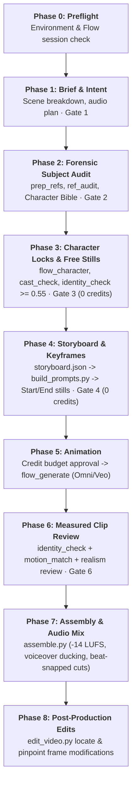

# Flow Film Director: End-to-End Production Methodology

This document details the exact engineering and directing methodology used by **Flow Film Director** and the **`video-creator` agent** to produce production-grade, identity-consistent videos using Google Flow (Veo / Omni video and Nano Banana images via `flow-mcp`).

---

## 1. The Core Problem in Generative Video

Standard generative AI video models (text-to-video and simple image-to-video) suffer from severe failure modes when tasked with making a continuous, multi-shot film:

1. **Identity Drift**: A character's facial structure, hair, eye shape, and age change in every shot, turning the subject into "a distant cousin".
2. **Multi-Subject Feature Bleed**: When two or more people are in the same scene, the model mixes their features (hair, beards, skin tone, or wardrobe swap between actors).
3. **Hallucinated Actions & Rubber Limbs**: Fast, ambiguous, or multi-part action prompts cause limbs to bend unnaturally, hands to merge into props, or bodies to morph.
4. **Environment & Prop Inconsistency**: Buildings, rooms, clothing, and products shift in color, layout, and branding between scenes.
5. **Credit Waste**: Users spend dozens or hundreds of credits generating bad takes without verification gates.

Flow Film Director eliminates these issues using a **deterministic, 8-phase gated pipeline** where **nothing advances to paid rendering until verified at 0 credits**, and **every clip is scored numerically and visually before acceptance**.

---

## 2. The 8-Phase Gated Pipeline Architecture

### Phase 0: Preflight & Environment
- Validates the Google Flow authentication and credit balance via `flow_status`.
- Sets up an isolated Python environment (`~/.flow-film/venv`) with pinned OpenCV and MediaPipe.
- Applies the `patch_flow_mcp.py` fix to prevent character prefix collisions in Flow asset attachments.

### Phase 1: Intent Profile & Scene Breakdown
- Determines project mode:
  - **Mode A (Replicate)**: Shot-for-shot remake of a reference video (timed beats, pose tracking).
  - **Mode B (Original Story)**: Written concept with explicit scene-by-scene action and camera moves.
- Establishes the **Intent Profile** (`story`, `talking_head`, `product_ad`, `music_video`, `action`).
- Enforces the golden action rule: **one physical action and one camera move per 4–8 second shot**.
- **Gate 1**: User approves `brief.md` before any generation begins.

### Phase 2: Forensic Reference Audit & Character Bible
- **Reference Cleaning (`prep_refs.py`)**: Strips mobile screenshot UI, status bars, and Instagram overlays that Flow otherwise incorporates into scenes.
- **Biometric Audit (`ref_audit.py`)**: Uses OpenCV SFace embeddings to calculate facial similarity across reference photos, flagging conflicting hairstyles, beards, glasses, and mirrored selfies.
- **Character Lock Text**: Writes concise (60–110 words) anatomical and wardrobe locks into `bible/<Name>.lock.txt`.
- **Gate 2**: User confirms the audit, bible, and chosen reference photos.

### Phase 3: Character Locks & Verification Stills (0 Credits)
- Checks candidate portraits with `cast_check.py` (ensures single face, face >= 18% of frame height).
- Registers the character in Flow: `flow_character(name, image=<path>)`.
- Applies the lock text via `flow_character_edit(name, look=<lock>)` without triggering `change` (preserving the original photo portrait).
- Generates a full verification matrix at **0 credits** (front, 3/4 left, 3/4 right, profile, medium standing, smiling).
- Scores each still using `identity_check.py` (cosine threshold >= 0.55–0.60).
- **Gate 3**: All verification stills pass before moving to storyboarding.

### Phase 4: Storyboard & Verified Keyframes (0 Credits)
- Storyboard compiled strictly from `storyboard.json` via `build_prompts.py` (zero hand-edited prompts).
- Generates START keyframes at **0 credits**.
- Evaluates each candidate against character face embeddings. The accepted frame is copied to `keyframes/scene-NN-start.png`.
- In precise mode, generates END keyframes anchored to the accepted START frame.
- **Gate 4**: User approves the keyframe contact sheet.

### Phase 5: Animation (Paid Credits — Explicit User Approval)
- `build_prompts.py` generates `prompts/stage3-video.json` with exact credit calculations.
- User gives explicit OK for the quoted credit cost.
- Video is generated **from the verified start keyframe** (`first_frame`).
- Credit expenditures are logged in `ledger.md`.

### Phase 6: Measured Clip Review & Fix Loop
- **Biometric Verification**: `identity_check.py --every 0.25 <clip>` verifies face scores across all frames.
- **Motion Matching**: In Mode A, `motion_match.py` verifies pose and camera alignment against reference video frames.
- **Realism Audit**: Frame-by-frame review via `contact_sheet.py` or `/watch-video` checking for rubber limbs, floating objects, or unnatural speeds.
- Defect resolution follows the deterministic rubric (adjusting single storyboard parameters rather than re-prompting from scratch).
- **Gate 6**: Every scene possesses an accepted take.

### Phase 7: Assembly & Audio Post-Production
- `assemble.py` concatenates accepted takes, aligns soundtrack cuts on musical beat markers, and applies audio ducking (-20 dB) under dialogue.
- Normalizes loudness to broadcast standard **-14 LUFS**.
- Performs a final full-video identity and continuity audit.

### Phase 8: Pinpoint Post-Production Edits
- When minor flaws appear, `edit_video.py locate` pinpoints the exact take and timestamp.
- Free post-production tools (trimming, speed re-timing, freeze-frames, blur, logo/text insertion) are applied before resorting to re-rendering.

---

## 3. Case Study 1: Hassen's Story — Docu-Narrative

- **Video Deliverable**: [`hassen_story.mp4`](./example1_hassen_story/hassen_story.mp4) (54s, 1080p Cinematic Widescreen)
- **Start Reference Photo**: [`start_reference.jpg`](./example1_hassen_story/start_reference.jpg)
- **Intent**: `story` + `talking_head` (Inspirational biographical narrative)

### The Challenge
Telling a 60-second biographical story across **8 radically different locations and contexts**:
1. Sunlit student desk in Tunisia
2. Airport departure terminal
3. Historic university library at UNIVPM in Italy
4. University cloister walkway
5. High-tech AI & robotics laboratory
6. Deep learning workstation with dual monitors
7. Coastal terrace overlooking the Adriatic sea in Ancona
8. Studio close-up addressing the viewer

### How Consistency Was Maintained
1. **Single Anchor Portrait**: `start_reference.jpg` was audited and locked as `asset:Hassen` with strict anatomical descriptors:
   > *"Late 20s, tall and slim, tight dark curls on top with short faded sides, long narrow face, short dense dark boxed beard, warm olive skin, grey see-through rounded-square glasses, dark navy blazer over dark grey crewneck."*
2. **Identity In Pixels**: Every scene started from a verified keyframe where Hassen's facial geometry was confirmed at >= 0.62 cosine likeness.
3. **Audio Architecture**: Spoken Arabic voiceover synchronized with scene beats and an ambient piano/strings soundtrack ducked -20 dB during speech.

---

## 4. Case Study 2: Marwen & Hassen — Action / Reference Remake

- **Video Deliverable**: [`marwen_hassen_action.mp4`](./example2_marwen_hassen_action/marwen_hassen_action.mp4) (51s, 1080p Action Remake)
- **Reference Photos**:
  - Hassen: [`ref_hassen.jpg`](./example2_marwen_hassen_action/ref_hassen.jpg)
  - Marwen: [`ref_marwen.jpg`](./example2_marwen_hassen_action/ref_marwen.jpg)
- **Intent**: `action` / `replicate` (Deadpool & Wolverine inspired staging)

### The Challenge
Multi-character video generation is notoriously prone to **cross-contamination**:
- The model often blends both faces into one generic actor.
- Costume elements swap between characters (e.g. Hassen wearing yellow armor, Marwen wearing the red suit).
- Rapid combat and stunt moves cause rubber limbs and melting weapons.

### Engineering Breakthroughs Applied
1. **Flow MCP Asset Fix (`patch_flow_mcp.py`)**: Fixed an asset prefix bug in `flow-mcp` where `asset:Hassen` accidentally attached video assets whose filenames began with `Hassen...`. The patch enforces exact asset resolution so both characters are cleanly bound.
2. **Contrastive Identity Locks**: Explicit character bibles highlighted differences between Hassen and Marwen:
   - *Hassen*: Tall, slim, curly hair, rectangular glasses, unmasked red tactical combat suit.
   - *Marwen*: Athletic build, skin fade, no glasses, distinctive facial structure, yellow-and-blue combat armor.
3. **Keyframe-to-Video Animation**: Zero-credit keyframes established staging, lighting, and combat postures before animating. Video rendering was anchored to these frames, ensuring the combat suit textures and facial likeness were preserved throughout dynamic physical actions.

---

## 5. Summary Quality Comparison

| Parameter | Traditional Unconstrained Prompting | Flow Film Director Pipeline |
|---|---|---|
| **Face Consistency** | Drifts every 3–5 seconds (0.15–0.35 cosine) | Locked across all shots (0.55–0.70+ cosine) |
| **Multi-Person Scenes** | Features blend and identities swap | Strict contrastive locks & exact asset binding |
| **Actions** | Rubber limbs, morphing objects, random speed changes | One physical action per shot, verified realism |
| **Credit Efficiency** | 50–70% of credits wasted on flawed takes | 0 credits for staging & keyframes; paid credits only for approved takes |
| **Audio & Post** | Silent or disconnected audio clips | Beat-synced timeline, -14 LUFS, voiceover ducking, pinpoint post-edits |
