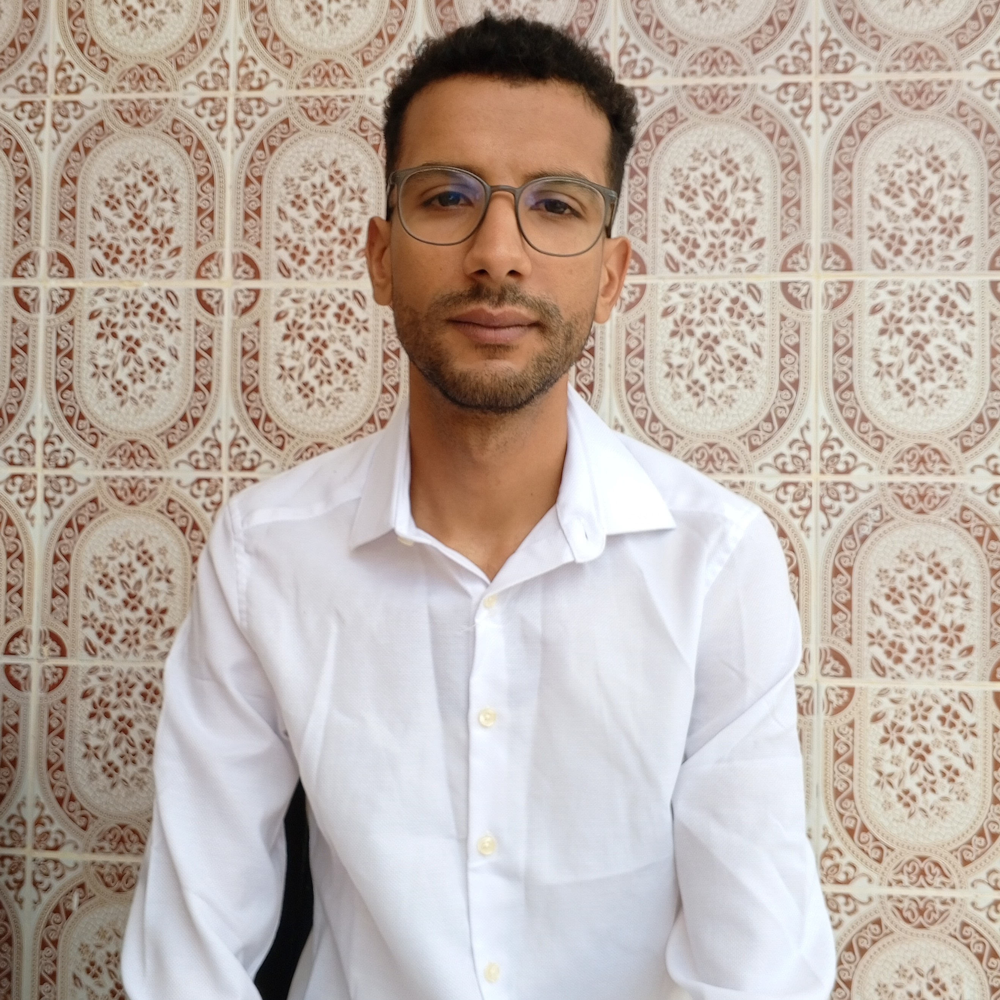
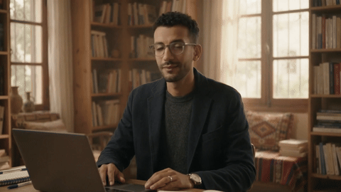

# Example 1: Hassen's Story — Docu-Narrative

An inspiring biographical video tracing Hassen's journey from Tunisia to completing his Master's in Data Science at UNIVPM and becoming an AI Engineer in Italy.

---

## Visual Comparison: Before & After

<table>
  <thead>
    <tr>
      <th width="35%" align="center">Before (Reference Photo)</th>
      <th width="65%" align="center">After (Generated Film)</th>
    </tr>
  </thead>
  <tbody>
    <tr>
      <td align="center" valign="middle">
        
      </td>
      <td align="center" valign="middle">
        
         
        <a href="hassen_story.mp4">▶ <b>Click to Watch Full Film with Arabic Voiceover (54.5s MP4)</b></a>
      </td>
    </tr>
  </tbody>
</table>

  <b>Before:</b> Real portrait photo &nbsp;→&nbsp; <b>After:</b> 54.5s Cinematic Docu-Narrative across 8 scenes with Arabic voiceover & ducked score

### Animated Clip Preview

   
  <i>Take preview: Hassen working in the AI & robotics laboratory</i>

---

## Production Parameters

| Parameter | Value |
|---|---|
| **Pipeline Mode** | Fast Mode with Google Flow Ingredients (`asset:Hassen`) |
| **Duration** | 54.5 seconds (8 narrative scenes) |
| **Aspect Ratio** | 16:9 Widescreen |
| **Voiceover** | Authentic Arabic biographical narrative |
| **Soundtrack** | Ambient piano/strings with automatic -20 dB ducking under speech |
| **Final Loudness** | -14 LUFS (two-pass normalization) |

---

## Scene Progression (Single Subject Across 8 Environments)

1. **Scene 1**: Sunlit study desk in Tunisia with laptop and textbooks.
2. **Scene 2**: Airport departure lounge, resolute and determined.
3. **Scene 3**: Late evening studying in the historic stone library at UNIVPM.
4. **Scene 4**: University cloister walkway smiling with pride.
5. **Scene 5**: Stepping into the high-tech AI & robotics laboratory.
6. **Scene 6**: AI workstation with dual monitors running deep learning training.
7. **Scene 7**: Coastal terrace in Ancona overlooking the Adriatic sea at golden hour.
8. **Scene 8**: Studio close-up with a direct, humble, inspiring closing message.

See [**`METHODOLOGY.md`**](../METHODOLOGY.md) for the complete engineering breakdown.
