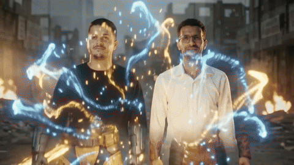

# Example 2: Marwen & Hassen — Action / Reference Remake

A dynamic, multi-character combat and choreography sequence inspired by high-octane superhero staging (Deadpool & Wolverine style), featuring two real individuals (Marwen and Hassen) in full tactical battle gear.

---

## Visual Comparison: Before & After

<table>
  <thead>
    <tr>
      <th width="35%" align="center">Before (Reference Photos)</th>
      <th width="65%" align="center">After (Generated Action Film)</th>
    </tr>
  </thead>
  <tbody>
    <tr>
      <td align="center" valign="middle">
        
        &nbsp;
        
      </td>
      <td align="center" valign="middle">
        
         
        <a href="marwen_hassen_action.mp4">▶ <b>Click to Watch Full Action Film with Soundtrack (51.5s MP4)</b></a>
      </td>
    </tr>
  </tbody>
</table>

  <b>Before:</b> Real reference photos of Hassen & Marwen &nbsp;→&nbsp; <b>After:</b> 51.5s Multi-Character Combat Staging with preserved identities and costumes

### Animated Clip Preview

   
  <i>Take preview: synchronized combat choreography with consistent facial features</i>

---

## Production Parameters

| Parameter | Value |
|---|---|
| **Pipeline Mode** | Precise Keyframe-to-Video Mode (`first_frame` anchoring) |
| **Duration** | 51.5 seconds |
| **Characters** | 2 recurring real subjects (`asset:Hassen` + `asset:Marwen`) |
| **Staging Inspiration** | Reference combat choreography |
| **Identity Safeguards** | Contrastive look texts + Flow MCP exact character attachment patch |
| **Soundtrack** | High-energy combat score beat-synced to cuts |

---

## Technical Highlights

- **Zero Face Blending**: Strict character locks and facial embedding tracking prevented the two actors from morphing into each other.
- **Accurate Wardrobe Retention**: Hassen maintained his unmasked red tactical combat suit with dual katana hilts; Marwen maintained his yellow-and-blue combat armor.
- **Dynamic Physics**: Stunt actions were broken down into distinct physical movements per shot to avoid rubber limbs and melting weapons.

See [**`METHODOLOGY.md`**](../METHODOLOGY.md) for the complete engineering breakdown.
