# Example 3: Horror in the Mosque (`HorrorMosque60`) — 3-Character Bridge-Locked Continuity

A 57.88-second live-action supernatural horror short film starring **Hassen** (`person`), a **Demon** (`creature`), and a **Guardian Angel** (`person`) set inside a moonlit stone mosque. Built to stress-test multi-character separation, 0-credit storyboard gating, selective multi-speaker voice cloning, and **v1.5.0 bridge-locked scene transitions**.

---

## Visual Showcase: Before (`v1` Broken Cuts) vs. After (`v2` Seamless Continuity)

<table>
  <thead>
    <tr>
      <th width="36%" align="center">Locked 3-Character Cast</th>
      <th width="64%" align="center">Generated Continuous Film (`v2` — 57.88s)</th>
    </tr>
  </thead>
  <tbody>
    <tr>
      <td align="center" valign="middle">
        
        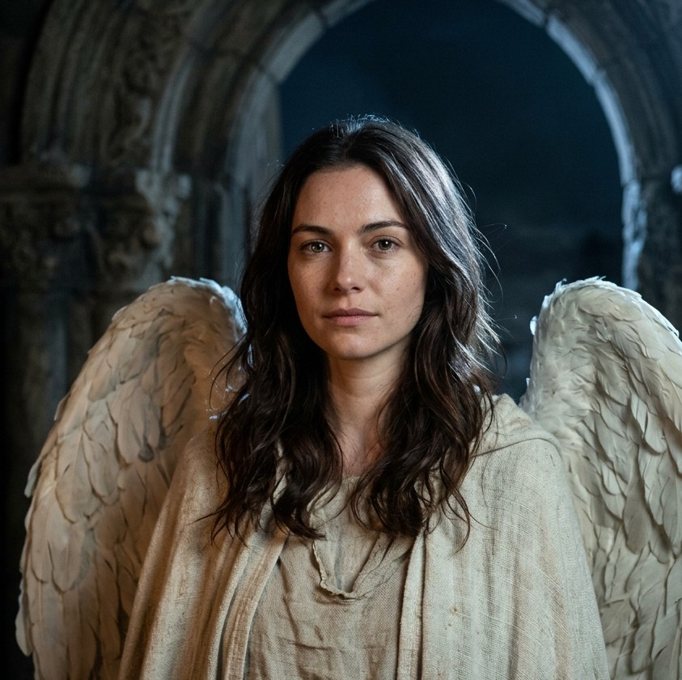
        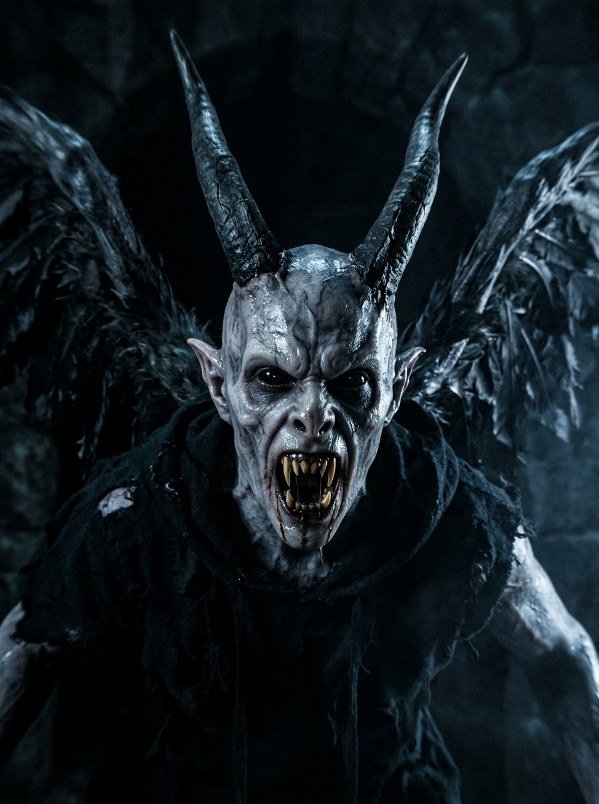 
        <b>Hassen</b> (Actor) · <b>Angel</b> (Protector) · <b>Demon</b> (Creature)
      </td>
      <td align="center" valign="middle">
        <a href="horror_mosque_v2.mp4" title="Click to watch full v2 seamless film (57.88s MP4 · No Sound)">
          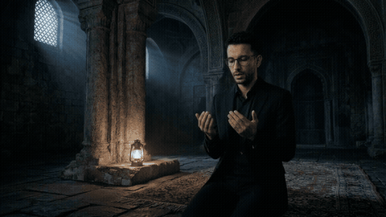
        </a>
         
        
          <a href="horror_mosque_v2.mp4">▶ <b>Watch v2 Seamless Master (57.88s MP4 · No Sound)</b></a>
          &nbsp;|&nbsp;
          <a href="horror_mosque_v1.mp4">Compare v1 Baseline (60.0s Un-Bridged · No Sound)</a>
        
      </td>
    </tr>
  </tbody>
</table>

---

## Storyboard & Bridge-Locked Transition Plan (`0` Credits)

Every shot was staged at **0 Flow credits** using Nano Banana keyframes before spending video credits, then re-anchored across Scenes 3–6 using `bridge_from_prev` (`accepted.end -> next START`) so characters stay locked to their screen sides without teleporting.

| Start / End Keyframe Storyboard (`storyboard.png`) | v2 Bridge-Locked Transition Anchors (`transition_board.png`) |
|---|---|
| [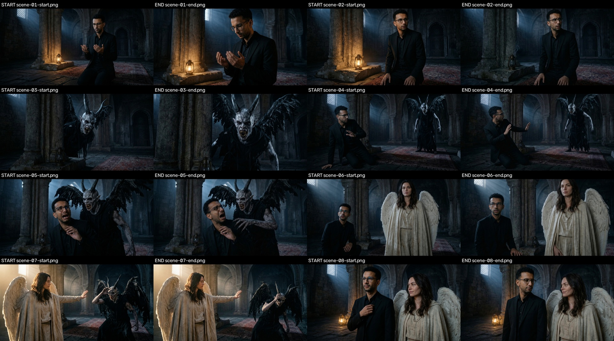](storyboard.png) | [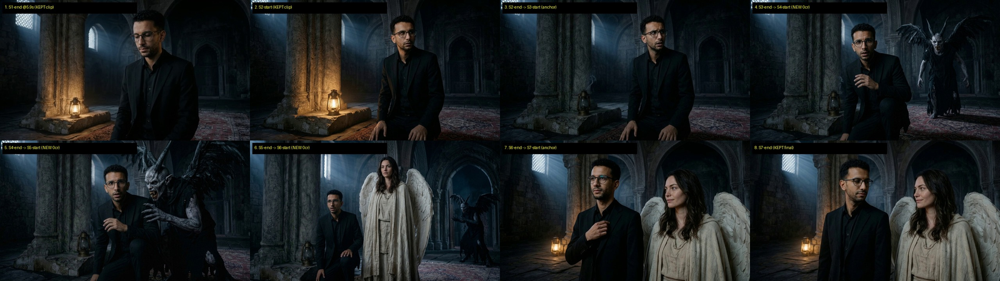](transition_board.png) |

---

## Forensic Analyses & Bounding-Box Audits

### 1. Cast Reference Audit & 0-Credit Portrait Verification (`YuNet` + `SFace`)

| Raw Input Audit Boxes (`ref_audit_boxes.jpg`) | Cast Still Verification Boxes (`cast_identity_boxes.jpg`) |
|---|---|
| [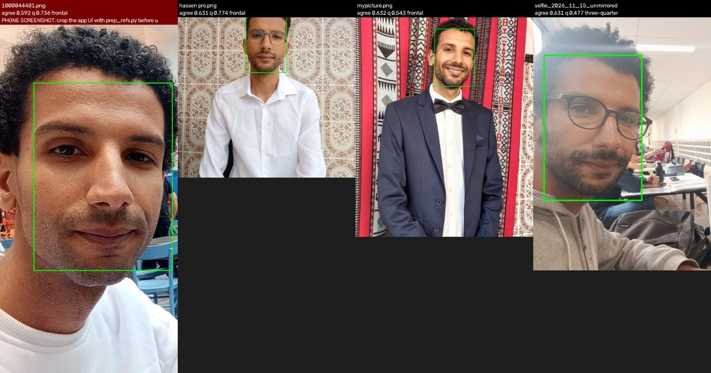](ref_audit_boxes.jpg) | [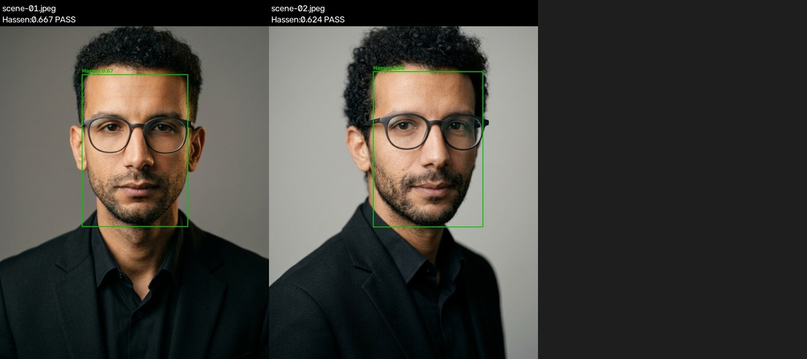](cast_identity_boxes.jpg) |
| Detects green YuNet face boxes &amp; flags phone UI screenshots (<code>Hassen</code> baseline <code>0.62</code>) | 0-credit cast portraits verified at <code>0.667 PASS</code> (frontal) &amp; <code>0.624 PASS</code> (3/4) |

<b>View 0-Credit Cast Refinement (Before vs. After for Angel, Demon, and Hassen)</b>

| Subject | Upgrade Applied at 0 Credits | Comparison |
|---|---|---|
| **Hassen** | Phone screenshots un-mirrored & cropped into studio portrait lock (`0.667 PASS`) | [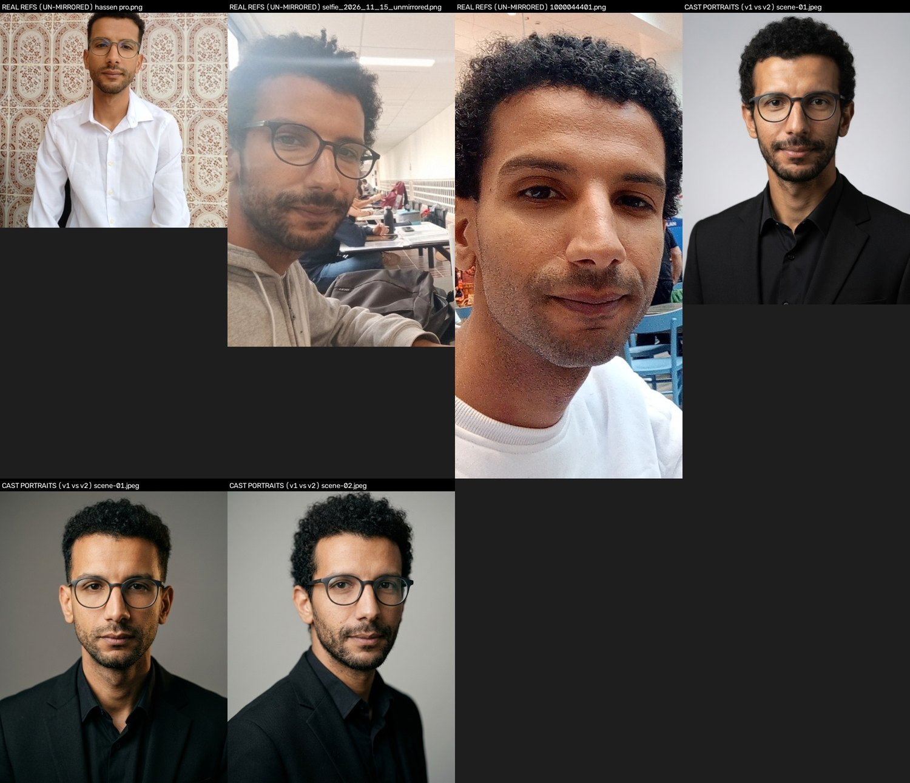](hassen_refs_vs_cast.jpg) |
| **Angel** | Plastic CGI look replaced with 35mm live-action atmospheric portrait (`0.138` cross-sim vs. Hassen) | [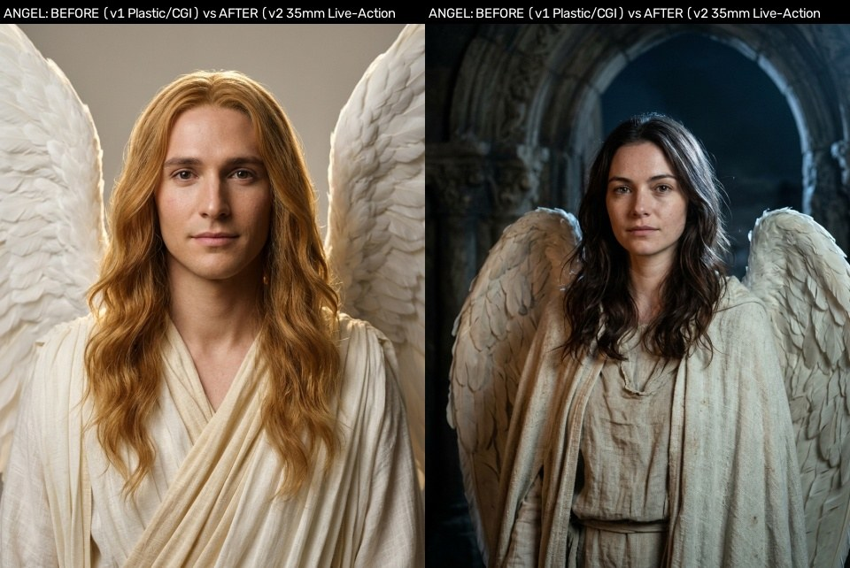](angel_before_vs_after.jpg) |
| **Demon** | Upgraded to tattered soot-black shroud, curved horns & wet fangs behind dark stone pillars | [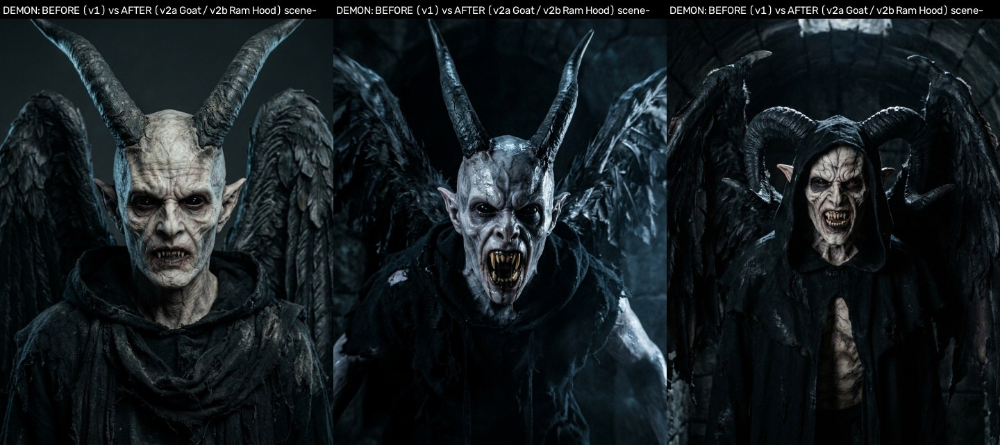](demon_before_vs_after.jpg) |

---

### 2. Full-Film Multi-Character Bounding-Box Tracking (`v1` vs. `v2`)

`identity_check.py --every 0.5` draws color-coded YuNet bounding boxes (`green >= 0.50`, `yellow = moderate/profile`, `red = low / secondary creature face`) across all sampled film frames:

| `v1` Baseline Boxes (`identity_boxes_v1.jpg`) | `v2` Seamless Film Boxes (`identity_boxes_v2.jpg`) |
|---|---|
| [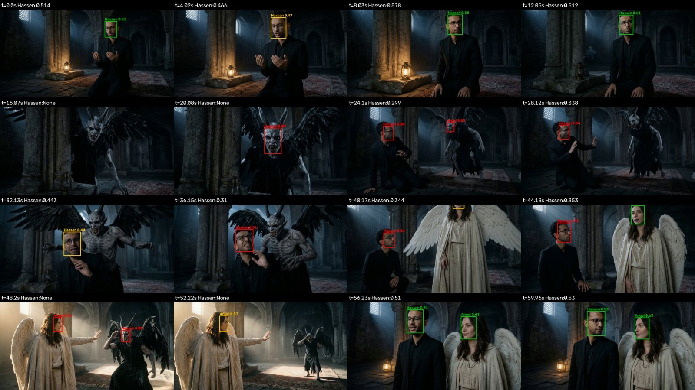](identity_boxes_v1.jpg) | [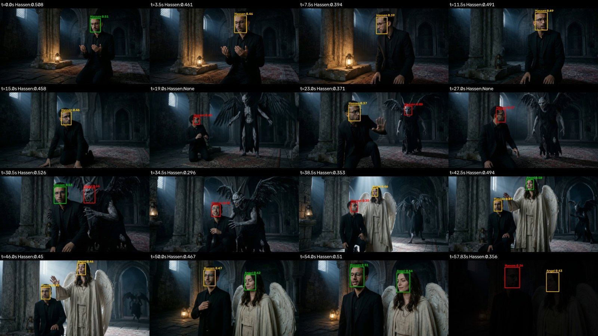](identity_boxes_v2.jpg) |

- **Per-Scene Verified Pass Scores (`v2`):** `scene-04-v2` Hassen `0.474 PASS` (`39/41` frames); `scene-06-v2` **`all_pass: true`** (`Hassen 0.478 PASS`, `Angel 0.512 PASS`, `41/41` frames); Finale (`scene-08`) **`all_pass: true`** (`Hassen 0.530 PASS`, `Angel 0.626 PASS`, `25/25` frames).
- **Whole-Film Automated Readout:** `Hassen` detected in `108/117` frames (`mean: 0.457`, dipping only during 80° horror profiles toward the Demon and upward scream in Scene 5) and `Angel` in `44/117` frames (`mean: 0.511`, appearing in the rescue and finale); the Demon skull triggers the red secondary creature box while remaining cleanly separated.

---

### 3. Cut-Seam Transition Audit (`edit_video.py audit`) — `v1` vs. `v2`

| `v1` Broken Cut Boundaries (`cut_audit_v1.jpg`) | `v2` Frame-Locked Transitions (`cut_audit_v2.jpg`) |
|---|---|
| [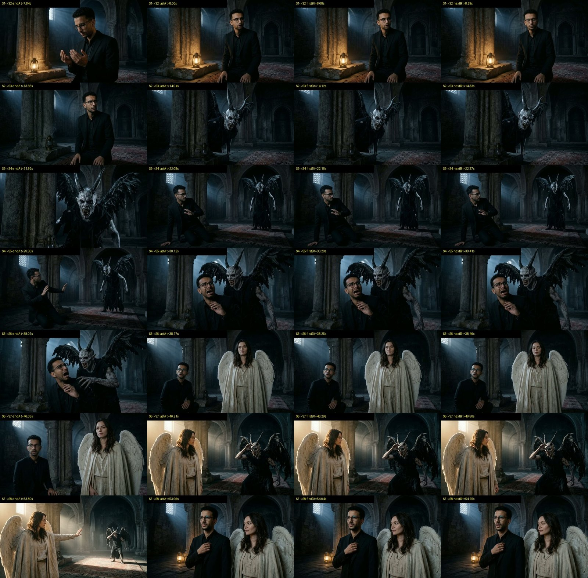](cut_audit_v1.jpg) | [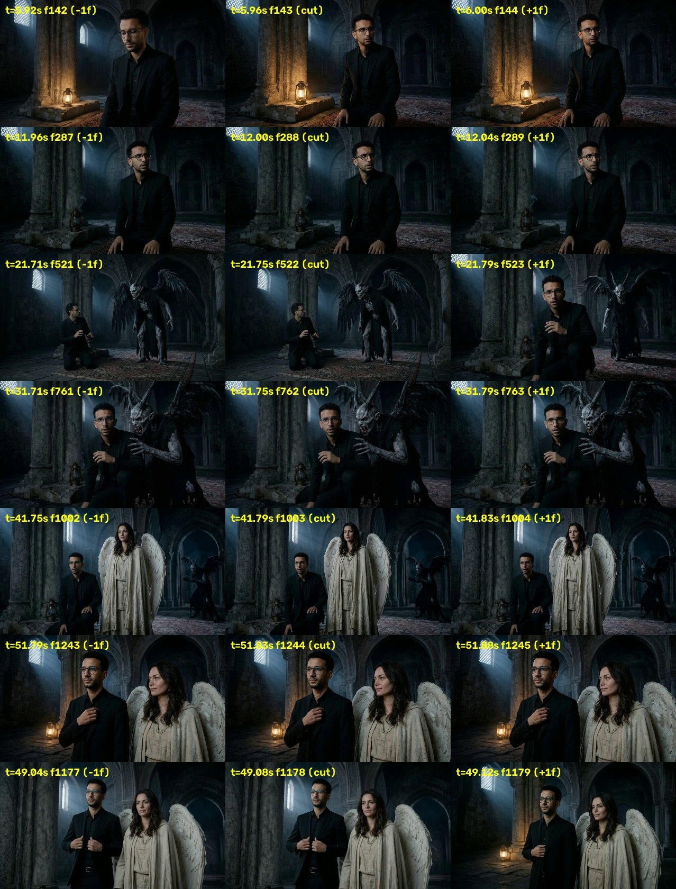](cut_audit_v2.jpg) |

| Transition Cut | `v1` Baseline Seam `MAE` | `v1` Failure Mode | `v2` Seam `MAE` | `v2` Continuity Fix |
|---|---|---|---|---|
| `Scene 1 -> 2` | `23.50` (`cut`) + `19.57` tail jump | Random late hand-raise back up at `6.0s` | `15.73` (`cut`) | Trimmed `scene-01` (`[0.0, 5.95]`) before tail movement |
| `Scene 2 -> 3` | `15.62` (`cut`) | Hassen vanishes in 1 frame; Demon spawns | **`2.05` (`frame_locked`)** | Bridged directly from `anchor-s2-end.png` (`0` credits) |
| `Scene 3 -> 4` | `21.95` (`cut`) | Disjointed jump + 4-frame tail flash | `22.64` (`cut`) | Clean punch-in; `scene-03-v2` trimmed `[0.0, 9.75]` (`0` word loss) |
| `Scene 4 -> 5` | `26.10` (`cut`) | Demon teleports to neck & robe melts off | **`2.24` (`frame_locked`)** | Anchored grab pose & continuous ragged shroud |
| `Scene 5 -> 6` | `38.03` (`cut`) | Demon disappears; Angel crown slightly cropped | **`3.87` (`frame_locked`)** | Silver light beam drives Demon back as Angel enters |
| `Scene 6 -> 7/8` | `56.51` & `58.83` (`cut`) | 180° screen flip + sunny afternoon snap | **`2.11` (`frame_locked`)** | Locked left/right sanctuary layout + warm lantern reveal |

---

## Audio, Cloned Arabic Dialogue & Credits

> [!NOTE]
> **Security Notice (Silent GitHub Showcase):** For security concerns, examples and test cases containing the author's original voice audio cannot be posted publicly on GitHub. Both [`horror_mosque_v2.mp4`](horror_mosque_v2.mp4) and [`horror_mosque_v1.mp4`](horror_mosque_v1.mp4) have had their audio tracks removed (`video-only`), while all biometric similarity and ASR word counts below were verified locally on the private master.

- **Selective Multi-Speaker `--map` Cloning:** Replaced **only** Hassen's Arabic lines while leaving Demon snarls and Angel speech untouched (`scene-01` `0.867 PASS`, `scene-02` `0.859 PASS`, `scene-04-v2` `--map "0.0-5.2=Hassen"` `0.808`, `scene-05-v2` `--map "0.0-3.5=Hassen"` `0.860 PASS` / `+5 ms` drift, `scene-08` `0.814`).
- **Broadcast Master & ASR:** `57.875s` (`1280x720`, `24 fps`), **`-14.29 LUFS`**, `-1.34 dBTP` true peak, **`43/43` intelligible Arabic words** transcribed on the final MP4 via `flow_transcribe`.
- **Flow Credit Spend:** `0` credits for cast audits, keyframes, and v2 transition bridges; `92` credits for the `v1` 8-clip shoot and `60` credits (`15 x 4`) for the `v2` middle-act continuity overhaul.

See [**`METHODOLOGY.md`**](../METHODOLOGY.md) for the complete engineering breakdown.
